<div align="right" >
    <b>Selecione um idioma:</b><br>
    <button><a href ="README_English/README.en.md">English</a></button>
    
</div>


# 💸 FinBuddy: Economia sem Drama

> Aplicativo de organização financeira criado utilizando os conceitos de Vibe Coding, Inteligência Artificial e planejamento de MVP.

## 📖 Sobre o Projeto

Este projeto foi desenvolvido como parte do desafio **App de Organização de Finanças Pessoais com Vibe Coding** da DIO.

A proposta era utilizar IA como parceira criativa para transformar uma ideia em um conceito de produto, explorando técnicas de comunicação, construção de prompts e definição de requisitos sem necessariamente implementar o código da aplicação. 

---

# 🎯 Problema

Muitas pessoas desejam organizar suas finanças, mas acabam abandonando aplicativos tradicionais por exigirem preenchimento manual excessivo, categorização complexa e pouca personalização.

Este projeto propõe uma experiência baseada em conversa natural com IA, tornando o controle financeiro mais simples e acessível.

---

# 👤 Público-Alvo

- Jovens adultos
- Universitários
- Pessoas iniciantes em educação financeira
- Usuários que preferem conversas em vez de planilhas

---

# 🚀 Solução Proposta

O aplicativo funciona como um assistente financeiro inteligente capaz de:

- Registrar despesas através de conversas
- Registrar receitas em linguagem natural
- Classificar gastos automaticamente
- Sugerir planos de economia
- Auxiliar na criação de metas financeiras
- Gerar relatórios simples e intuitivos
- Criar planejamentos de rotina relacionados a finanças e consumo

---

# 📝 PRD Final (Prompt Utilizado)

    # Contexto

    Quero criar um aplicativo chamado **FinBuddy**, um assistente financeiro conversacional voltado para jovens adultos da Geração Z.

    O objetivo é ajudar usuários a planejar melhor sua vida financeira através de conversas naturais com uma IA, eliminando a necessidade de planilhas complexas, formulários extensos e processos burocráticos.

    O FinBuddy não será apenas um aplicativo para registrar gastos. Ele atuará como um copiloto financeiro pessoal, ajudando o usuário a:

    - Registrar despesas e receitas por conversa.
    - Planejar sua semana.
    - Organizar metas financeiras.
    - Planejar refeições e compras.
    - Avaliar decisões de consumo.
    - Entender melhor seus hábitos financeiros.

    A experiência deve ser simples, amigável, moderna e adaptada ao comportamento de usuários que já utilizam ferramentas como WhatsApp, Discord, ChatGPT e TikTok.

    ---

    # Problema

    Muitos jovens adultos desejam organizar suas finanças, mas encontram dificuldades porque os aplicativos atuais:

    - Exigem muito preenchimento manual.
    - Possuem interfaces complexas.
    - Não ajudam no planejamento do dia a dia.
    - Oferecem pouca personalização.
    - Apenas registram gastos, sem ajudar na tomada de decisão.

    Como consequência, usuários abandonam rapidamente o controle financeiro e continuam tomando decisões sem planejamento.

    O FinBuddy deve resolver esse problema utilizando IA conversacional para orientar o usuário antes, durante e depois de suas decisões financeiras.

    ---

    # Público-Alvo

    ## Público Primário

    Jovens entre 18 e 30 anos:

    - Universitários.
    - Estagiários.
    - Jovens profissionais.
    - Freelancers.
    - Pessoas iniciando sua independência financeira.

    ## Características

    - Preferem experiências simples e rápidas.
    - Estão acostumados a interfaces baseadas em conversa.
    - Possuem pouco conhecimento financeiro.
    - Gostam de personalização e feedback imediato.
    - Precisam de ajuda para planejar gastos e atingir objetivos.

    ---

    # Proposta de Valor

    > Planeje sua vida financeira conversando.

    Ao invés de apenas controlar despesas, o FinBuddy ajuda o usuário a criar hábitos financeiros saudáveis através de planejamento, orientação e acompanhamento personalizado.

    ---

    # Funcionalidades-Chave

    ## Controle Financeiro

    1. Registrar gastos através de linguagem natural.
    2. Registrar receitas através de linguagem natural.
    3. Classificar transações automaticamente.
    4. Exibir dashboard financeiro simplificado.
    5. Gerar relatórios e insights personalizados.

    ## Metas Financeiras

    6. Criar metas financeiras.
    7. Acompanhar progresso das metas.
    8. Simular cenários para alcançar objetivos.

    ## Agente Financeiro

    9. Responder dúvidas financeiras.
    10. Fornecer dicas personalizadas de economia.
    11. Identificar padrões de gasto.
    12. Alertar sobre comportamentos que atrapalhem metas financeiras.

    ## Reality Check

    13. Avaliar o impacto de compras antes que elas aconteçam.

    Exemplo:

    > Posso comprar um notebook de R$4.000?

    A IA deve analisar saldo, orçamento e metas antes de responder.

    ## Planejamento Financeiro

    14. Criar planejamentos semanais.
    15. Estimar gastos futuros.
    16. Organizar orçamentos para eventos e objetivos.

    ## Planejamento de Alimentação e Compras

    17. Gerar listas de compras com base em orçamento disponível.
    18. Sugerir refeições compatíveis com o orçamento.
    19. Ajudar o usuário a economizar com alimentação.
    20. Planejar gastos semanais relacionados ao mercado.

    ---

    # Personalidade do Produto

    O usuário deve poder escolher o estilo do Agente Financeiro:

    - 🫂 Melhor Amigo
    - 🎯 Reality Check
    - 🚀 Coach
    - 🤖 Geek

    Toda comunicação deve utilizar linguagem informal, acolhedora e acessível para jovens adultos.

    ---

    # Diferenciais do Produto

    - Conversa em linguagem natural.
    - Planejamento financeiro proativo.
    - Planejamento alimentar baseado em orçamento.
    - Lista de compras inteligente.
    - Simulação de decisões financeiras.
    - Insights personalizados.
    - Personalidade customizável da IA.
    - Experiência focada na Geração Z.

    ---

    # Entregável da IA

    Gerar um plano completo de MVP contendo:

    1. Visão geral do produto.
    2. Funcionalidades do MVP.
    3. Fluxo principal do usuário.
    4. Principais telas.
    5. Estrutura de navegação.
    6. Requisitos funcionais.
    7. Requisitos não funcionais.
    8. Métricas de sucesso.
    9. Hipóteses de validação.
    10. Funcionalidades futuras (V2).

    Utilizar linguagem clara, educativa e acessível.

    O resultado deve ter nível de detalhamento suficiente para servir como base de design UX/UI, documentação de produto e desenvolvimento utilizando ferramentas de Vibe Coding.


---

# 🤖 Interações com a IA

Para tornar o escopo completo antes do desenvolvimento do aplicativo, foi utilizado o Microsoft Copilot para o refinamento do PRD.


## Primeira versão do PRD

````text
    # PRD - FinBuddy

    ## Assistente Financeiro e de Planejamento para Geração Z

    ---

    # 1. Visão do Produto

    **FinBuddy** é um assistente financeiro conversacional criado para ajudar jovens adultos a planejar melhor sua vida financeira, organizar sua rotina de gastos e tomar decisões mais inteligentes no dia a dia.

    Diferente dos aplicativos tradicionais de finanças, o FinBuddy não se limita ao registro de despesas. Ele atua como um copiloto financeiro pessoal, auxiliando o usuário antes, durante e depois de suas decisões de consumo.

    O usuário pode conversar naturalmente com a IA para:

    - Registrar gastos e receitas.
    - Planejar sua semana.
    - Criar listas de compras.
    - Planejar refeições.
    - Acompanhar metas financeiras.
    - Simular compras futuras.
    - Receber recomendações personalizadas.

    Exemplos:

    > Gastei R$30 no almoço.

    > Tenho R$150 para passar a semana.

    > Monte uma lista de compras econômica.

    > Posso comprar um notebook este mês?

    ---

    # 2. Problema

    Muitos jovens adultos desejam organizar suas finanças, mas enfrentam dificuldades porque:

    - Os aplicativos financeiros são complexos.
    - O controle financeiro exige disciplina constante.
    - O registro manual de despesas é cansativo.
    - Faltam ferramentas para planejamento financeiro prático.
    - Grande parte dos gastos impulsivos acontece por falta de planejamento.

    Como consequência:

    - O usuário perde controle sobre o orçamento.
    - Acumula despesas desnecessárias.
    - Tem dificuldade em atingir objetivos financeiros.
    - Abandona aplicativos de finanças após poucos dias.

    ---

    # 3. Missão

    Ajudar jovens adultos a planejar sua vida financeira através de conversas inteligentes.

    ---

    # 4. Objetivos do Produto

    O FinBuddy deve:

    - Simplificar o controle financeiro.
    - Incentivar hábitos financeiros saudáveis.
    - Auxiliar no planejamento semanal.
    - Reduzir gastos impulsivos.
    - Facilitar o alcance de metas financeiras.
    - Transformar educação financeira em uma experiência prática.

    ---

    # 5. Público-Alvo

    ## Primário

    Jovens entre 18 e 30 anos:

    - Universitários.
    - Estagiários.
    - Jovens profissionais.
    - Freelancers.
    - Pessoas em início de independência financeira.

    ## Perfil Comportamental

    - Utilizam WhatsApp, Discord, TikTok e ChatGPT diariamente.
    - Preferem comunicação rápida e informal.
    - Gostam de experiências personalizadas.
    - Valorizam praticidade.
    - Possuem pouco conhecimento em finanças pessoais.

    ---

    # 6. Proposta de Valor

    > Planeje sua vida financeira conversando.

    Em vez de apenas registrar gastos, o usuário recebe ajuda para planejar melhor suas decisões, organizar seu orçamento e atingir seus objetivos.

    ---

    # 7. Diferenciais do Produto

    ## Conversa em Linguagem Natural

    O usuário consegue realizar praticamente qualquer ação através do chat.

    Exemplos:

    ```text
    Gastei R$25 no café.
    ```

    ```text
    Recebi R$1.200 hoje.
    ```

    ```text
    Quero economizar para uma viagem.
    ```

    ---

    ## Planejamento Financeiro Proativo

    O aplicativo auxilia antes dos gastos acontecerem.

    Exemplos:

    ```text
    Tenho R$100 para gastar essa semana.
    ```

    ```text
    Monte uma lista de compras econômica.
    ```

    ```text
    Quero reduzir meu gasto com alimentação.
    ```

    ---

    ## Personalidade do Agente

    O usuário escolhe o estilo do assistente.

    - 🫂 Melhor Amigo
    - 🎯 Reality Check
    - 🚀 Coach
    - 🤖 Geek

    ---

    ## Insights Inteligentes

    A IA detecta padrões de comportamento.

    Exemplo:

    ```text
    Você gastou 28% mais com delivery nesta semana.
    ```

    ---

    ## Reality Check

    Ajuda o usuário a avaliar compras antes de realizá-las.

    Exemplo:

    ```text
    Posso comprar um videogame de R$2.500?
    ```

    Resposta:

    ```text
    Pode.

    Mas isso consumiria 80% do seu saldo disponível
    e atrasaria sua meta da viagem em 3 meses.
    ```

    ---

    # 8. Funcionalidades do MVP

    ## F01 - Registro de Gastos

    O usuário registra despesas através do chat.

    Exemplos:

    ```text
    Gastei R$30 no almoço.
    ```

    ```text
    Paguei R$150 da academia.
    ```

    O sistema identifica:

    - Valor.
    - Categoria.
    - Data.
    - Tipo de transação.

    ---

    ## F02 - Registro de Receitas

    Exemplos:

    ```text
    Recebi meu salário.
    ```

    ```text
    Ganhei R$500 de freelance.
    ```

    ---

    ## F03 - Dashboard Financeiro

    Exibir:

    - Saldo atual.
    - Receitas.
    - Despesas.
    - Categorias de gastos.
    - Evolução financeira.

    ---

    ## F04 - Metas Financeiras

    Permitir criar objetivos como:

    - Notebook.
    - Viagem.
    - Curso.
    - Reserva de emergência.

    Exibir:

    - Valor objetivo.
    - Valor acumulado.
    - Percentual de progresso.
    - Previsão de conclusão.

    ---

    ## F05 - Agente Financeiro

    O agente poderá:

    - Responder dúvidas.
    - Gerar recomendações.
    - Orientar o usuário.
    - Explicar relatórios.

    ---

    ## F06 - Insights Financeiros

    Exemplos:

    ```text
    Seu gasto com transporte caiu 15% neste mês.
    ```

    ```text
    Você gastou R$180 com delivery nas últimas duas semanas.
    ```

    ---

    ## F07 - Reality Check

    Permite simular decisões de compra.

    Exemplo:

    ```text
    Posso comprar um tênis de R$400?
    ```

    A IA analisa:

    - Saldo atual.
    - Metas existentes.
    - Impacto no orçamento.
    - Tempo adicional para atingir objetivos.

    ---

    # 9. Funcionalidades de Planejamento

    ## F08 - Planejamento Semanal

    O usuário informa sua rotina da semana.

    Exemplo:

    ```text
    Tenho aula de segunda a sexta
    e academia três vezes na semana.
    ```

    O sistema gera:

    - Estimativa de gastos.
    - Sugestões de economia.
    - Projeção semanal.

    ---

    ## F09 - Planejamento de Alimentação

    Exemplo:

    ```text
    Tenho R$200 para alimentação nesta semana.
    ```

    O sistema sugere:

    - Refeições.
    - Quantidade estimada.
    - Distribuição do orçamento.

    ---

    ## F10 - Lista de Compras Inteligente

    Exemplo:

    ```text
    Monte uma lista de mercado para uma semana com orçamento de R$150.
    ```

    O sistema gera:

    - Produtos sugeridos.
    - Estimativa de custo.
    - Adequação ao perfil do usuário.

    ---

    ## F11 - Planejamento de Objetivos

    Exemplo:

    ```text
    Quero comprar um notebook de R$4.500.
    ```

    O sistema informa:

    ```text
    3 meses → R$1.500/mês

    6 meses → R$750/mês

    12 meses → R$375/mês
    ```

    ---

    ## F12 - Planejamento de Eventos

    Exemplo:

    ```text
    Vou a um show em novembro.
    ```

    O sistema cria um orçamento estimado considerando:

    - Ingresso.
    - Alimentação.
    - Transporte.
    - Reserva financeira.

    ---

    # 10. Jornada do Usuário

    ## Primeiro Acesso

    ### Tela 1 - Splash

    ```text
    FinBuddy

    Seu dinheiro.
    Sua rotina.
    Seu plano.
    ```

    ↓

    ### Tela 2 - Cadastro

    ```text
    Nome
    Email
    Senha
    ```

    ↓

    ### Tela 3 - Perfil Financeiro

    ```text
    Qual sua renda mensal?
    ```

    ↓

    ### Tela 4 - Objetivo Inicial

    ```text
    O que você quer conquistar?
    ```

    ↓

    ### Tela 5 - Escolha do Agente

    ```text
    🫂 Melhor Amigo

    🎯 Reality Check

    🚀 Coach

    🤖 Geek
    ```

    ↓

    ### Tela 6 - Home (Chat)

    ---

    # 11. Estrutura de Navegação

    ```text
                HOME
            (CHAT IA)

    ┌──────┬──────┬──────┬──────┐
    │      │      │      │
    Dashboard Metas Planejamento Insights

                    │
                Perfil
    ```

    ---

    # 12. Fluxo Principal do Produto

    ```text
    Planejar
        ↓

    Executar
        ↓

    Registrar
        ↓

    Analisar
        ↓

    Melhorar
    ```

    ---

    # 13. Requisitos Funcionais

    ## RF01

    Registrar despesas via chat.

    ## RF02

    Registrar receitas via chat.

    ## RF03

    Classificar transações automaticamente.

    ## RF04

    Permitir criação de metas.

    ## RF05

    Exibir dashboard financeiro.

    ## RF06

    Fornecer insights personalizados.

    ## RF07

    Executar análises de compra.

    ## RF08

    Criar planejamentos semanais.

    ## RF09

    Gerar listas de compras.

    ## RF10

    Planejar alimentação baseada em orçamento.

    ## RF11

    Simular objetivos financeiros.

    ## RF12

    Gerar retrospectivas financeiras mensais.

    ---

    # 14. Requisitos Não Funcionais

    ## RNF01

    Interface mobile-first.

    ## RNF02

    Tempo de resposta inferior a 2 segundos.

    ## RNF03

    Experiência otimizada para Geração Z.

    ## RNF04

    Armazenamento seguro dos dados.

    ## RNF05

    Compatibilidade Android, iOS e Web.

    ## RNF06

    Linguagem simples e humanizada.

    ---

    # 15. Métricas de Sucesso

    ## Engajamento

    - Retenção D1 ≥ 60%
    - Retenção D7 ≥ 25%

    ## Uso

    - Média de 3 registros financeiros por dia.
    - Média de 1 planejamento semanal por usuário.

    ## Qualidade

    - 85% de classificação automática correta.

    ## Produto

    - 50% dos usuários criando metas financeiras.
    - 30% utilizando recursos de planejamento semanal.

    ---

    # 16. Hipóteses de Validação

    ## H1

    Usuários preferem registrar gastos via conversa.

    ### Validação

    Comparação com formulários tradicionais.

    ---

    ## H2

    Planejamento semanal reduz gastos impulsivos.

    ### Validação

    Comparação entre períodos planejados e não planejados.

    ---

    ## H3

    Reality Check aumenta o valor percebido do produto.

    ### Validação

    Análise de uso e entrevistas.

    ---

    ## H4

    Planejamento de alimentação e compras aumenta retenção.

    ### Validação

    Monitoramento de usuários que utilizam o recurso semanalmente.

    ---

    # 17. Fora do Escopo do MVP

    Não serão desenvolvidos inicialmente:

    - Open Finance.
    - Integrações bancárias.
    - Cartões de crédito.
    - Investimentos.
    - Pix automático.
    - OCR de comprovantes.
    - Comparação entre usuários.
    - Marketplace financeiro.

    ---

    # 18. Visão para V2

    ## Gamificação

    - XP financeiro.
    - Conquistas.
    - Níveis.
    - Streak diária.

    ## Educação Financeira

    - Trilhas de aprendizado.
    - Missões semanais.
    - Conteúdo personalizado.

    ## IA Avançada

    - Previsão de saldo.
    - Detecção de gastos impulsivos.
    - Sugestões automáticas de economia.

    ## Compartilhamento

    - Wrapped Financeiro.
    - Conquistas para Stories.

    ---

    # Resumo Executivo

    FinBuddy é um assistente financeiro conversacional que ajuda jovens adultos a planejar, executar e melhorar suas decisões financeiras.

    O produto combina:

    - Controle financeiro por chat.
    - Planejamento semanal.
    - Planejamento de alimentação.
    - Lista de compras inteligente.
    - Metas financeiras.
    - Reality Check.
    - Insights personalizados.

    Seu objetivo não é apenas registrar gastos, mas ajudar o usuário a tomar decisões melhores antes que o dinheiro seja gasto.

````

## Segunda versão do PRD


        # PRD - FinBuddy

    ## Assistente Financeiro e de Planejamento para Geração Z

    ---

    # 1. Visão do Produto

    **FinBuddy** é um assistente financeiro conversacional criado para ajudar jovens adultos a planejar melhor sua vida financeira, organizar sua rotina de gastos e tomar decisões mais inteligentes no dia a dia.

    Diferente dos aplicativos tradicionais de finanças, o FinBuddy não se limita ao registro de despesas. Ele atua como um copiloto financeiro pessoal, auxiliando o usuário antes, durante e depois de suas decisões de consumo.

    O usuário pode conversar naturalmente com a IA para:

    - Registrar gastos e receitas.
    - Planejar sua semana.
    - Criar listas de compras.
    - Planejar refeições.
    - Acompanhar metas financeiras.
    - Simular compras futuras.
    - Receber recomendações personalizadas.

    Exemplos:

    > Gastei R$30 no almoço.

    > Tenho R$150 para passar a semana.

    > Monte uma lista de compras econômica.

    > Posso comprar um notebook este mês?

    ---

    # 2. Problema

    Muitos jovens adultos desejam organizar suas finanças, mas enfrentam dificuldades porque:

    - Os aplicativos financeiros são complexos.
    - O controle financeiro exige disciplina constante.
    - O registro manual de despesas é cansativo.
    - Faltam ferramentas para planejamento financeiro prático.
    - Grande parte dos gastos impulsivos acontece por falta de planejamento.

    Como consequência:

    - O usuário perde controle sobre o orçamento.
    - Acumula despesas desnecessárias.
    - Tem dificuldade em atingir objetivos financeiros.
    - Abandona aplicativos de finanças após poucos dias.

    ---

    # 3. Missão

    Ajudar jovens adultos a planejar sua vida financeira através de conversas inteligentes.

    ---

    # 4. Objetivos do Produto

    O FinBuddy deve:

    - Simplificar o controle financeiro.
    - Incentivar hábitos financeiros saudáveis.
    - Auxiliar no planejamento semanal.
    - Reduzir gastos impulsivos.
    - Facilitar o alcance de metas financeiras.
    - Transformar educação financeira em uma experiência prática.

    ---

    # 5. Público-Alvo

    ## Primário

    Jovens entre 18 e 30 anos:

    - Universitários.
    - Estagiários.
    - Jovens profissionais.
    - Freelancers.
    - Pessoas em início de independência financeira.

    ## Perfil Comportamental

    - Utilizam WhatsApp, Discord, TikTok e ChatGPT diariamente.
    - Preferem comunicação rápida e informal.
    - Gostam de experiências personalizadas.
    - Valorizam praticidade.
    - Possuem pouco conhecimento em finanças pessoais.

    ---

    # 6. Proposta de Valor

    > Planeje sua vida financeira conversando.

    Em vez de apenas registrar gastos, o usuário recebe ajuda para planejar melhor suas decisões, organizar seu orçamento e atingir seus objetivos.

    ---

    # 7. Diferenciais do Produto

    ## Conversa em Linguagem Natural

    O usuário consegue realizar praticamente qualquer ação através do chat.

    Exemplos:

    ```text
    Gastei R$25 no café.
    ```

    ```text
    Recebi R$1.200 hoje.
    ```

    ```text
    Quero economizar para uma viagem.
    ```

    ---

    ## Planejamento Financeiro Proativo

    O aplicativo auxilia antes dos gastos acontecerem.

    Exemplos:

    ```text
    Tenho R$100 para gastar essa semana.
    ```

    ```text
    Monte uma lista de compras econômica.
    ```

    ```text
    Quero reduzir meu gasto com alimentação.
    ```

    ---

    ## Personalidade do Agente

    O usuário escolhe o estilo do assistente.

    - 🫂 Melhor Amigo
    - 🎯 Reality Check
    - 🚀 Coach
    - 🤖 Geek

    ---

    ## Insights Inteligentes

    A IA detecta padrões de comportamento.

    Exemplo:

    ```text
    Você gastou 28% mais com delivery nesta semana.
    ```

    ---

    ## Reality Check

    Ajuda o usuário a avaliar compras antes de realizá-las.

    Exemplo:

    ```text
    Posso comprar um videogame de R$2.500?
    ```

    Resposta:

    ```text
    Pode.

    Mas isso consumiria 80% do seu saldo disponível
    e atrasaria sua meta da viagem em 3 meses.
    ```

    ---

    # 8. Funcionalidades do MVP

    ## F01 - Registro de Gastos

    O usuário registra despesas através do chat.

    Exemplos:

    ```text
    Gastei R$30 no almoço.
    ```

    ```text
    Paguei R$150 da academia.
    ```

    O sistema identifica:

    - Valor.
    - Categoria.
    - Data.
    - Tipo de transação.

    ---

    ## F02 - Registro de Receitas

    Exemplos:

    ```text
    Recebi meu salário.
    ```

    ```text
    Ganhei R$500 de freelance.
    ```

    ---

    ## F03 - Dashboard Financeiro

    Exibir:

    - Saldo atual.
    - Receitas.
    - Despesas.
    - Categorias de gastos.
    - Evolução financeira.

    ---

    ## F04 - Metas Financeiras

    Permitir criar objetivos como:

    - Notebook.
    - Viagem.
    - Curso.
    - Reserva de emergência.

    Exibir:

    - Valor objetivo.
    - Valor acumulado.
    - Percentual de progresso.
    - Previsão de conclusão.

    ---

    ## F05 - Agente Financeiro

    O agente poderá:

    - Responder dúvidas.
    - Gerar recomendações.
    - Orientar o usuário.
    - Explicar relatórios.

    ---

    ## F06 - Insights Financeiros

    Exemplos:

    ```text
    Seu gasto com transporte caiu 15% neste mês.
    ```

    ```text
    Você gastou R$180 com delivery nas últimas duas semanas.
    ```

    ---

    ## F07 - Reality Check

    Permite simular decisões de compra.

    Exemplo:

    ```text
    Posso comprar um tênis de R$400?
    ```

    A IA analisa:

    - Saldo atual.
    - Metas existentes.
    - Impacto no orçamento.
    - Tempo adicional para atingir objetivos.

    ---

    # 9. Funcionalidades de Planejamento

    ## F08 - Planejamento Semanal

    O usuário informa sua rotina da semana.

    Exemplo:

    ```text
    Tenho aula de segunda a sexta
    e academia três vezes na semana.
    ```

    O sistema gera:

    - Estimativa de gastos.
    - Sugestões de economia.
    - Projeção semanal.

    ---

    ## F09 - Planejamento de Alimentação

    Exemplo:

    ```text
    Tenho R$200 para alimentação nesta semana.
    ```

    O sistema sugere:

    - Refeições.
    - Quantidade estimada.
    - Distribuição do orçamento.

    ---

    ## F10 - Lista de Compras Inteligente

    Exemplo:

    ```text
    Monte uma lista de mercado para uma semana com orçamento de R$150.
    ```

    O sistema gera:

    - Produtos sugeridos.
    - Estimativa de custo.
    - Adequação ao perfil do usuário.

    ---

    ## F11 - Planejamento de Objetivos

    Exemplo:

    ```text
    Quero comprar um notebook de R$4.500.
    ```

    O sistema informa:

    ```text
    3 meses → R$1.500/mês

    6 meses → R$750/mês

    12 meses → R$375/mês
    ```

    ---

    ## F12 - Planejamento de Eventos

    Exemplo:

    ```text
    Vou a um show em novembro.
    ```

    O sistema cria um orçamento estimado considerando:

    - Ingresso.
    - Alimentação.
    - Transporte.
    - Reserva financeira.

    ---

    # 10. Jornada do Usuário

    ## Primeiro Acesso

    ### Tela 1 - Splash

    ```text
    FinBuddy

    Seu dinheiro.
    Sua rotina.
    Seu plano.
    ```

    ↓

    ### Tela 2 - Cadastro

    ```text
    Nome
    Email
    Senha
    ```

    ↓

    ### Tela 3 - Perfil Financeiro

    ```text
    Qual sua renda mensal?
    ```

    ↓

    ### Tela 4 - Objetivo Inicial

    ```text
    O que você quer conquistar?
    ```

    ↓

    ### Tela 5 - Escolha do Agente

    ```text
    🫂 Melhor Amigo

    🎯 Reality Check

    🚀 Coach

    🤖 Geek
    ```

    ↓

    ### Tela 6 - Home (Chat)

    ---

    # 11. Estrutura de Navegação

    ```text
                HOME
            (CHAT IA)

    ┌──────┬──────┬──────┬──────┐
    │      │      │      │
    Dashboard Metas Planejamento Insights

                    │
                Perfil
    ```

    ---

    # 12. Fluxo Principal do Produto

    ```text
    Planejar
        ↓

    Executar
        ↓

    Registrar
        ↓

    Analisar
        ↓

    Melhorar
    ```

    ---

    # 13. Requisitos Funcionais

    ## RF01

    Registrar despesas via chat.

    ## RF02

    Registrar receitas via chat.

    ## RF03

    Classificar transações automaticamente.

    ## RF04

    Permitir criação de metas.

    ## RF05

    Exibir dashboard financeiro.

    ## RF06

    Fornecer insights personalizados.

    ## RF07

    Executar análises de compra.

    ## RF08

    Criar planejamentos semanais.

    ## RF09

    Gerar listas de compras.

    ## RF10

    Planejar alimentação baseada em orçamento.

    ## RF11

    Simular objetivos financeiros.

    ## RF12

    Gerar retrospectivas financeiras mensais.

    ---

    # 14. Requisitos Não Funcionais

    ## RNF01

    Interface mobile-first.

    ## RNF02

    Tempo de resposta inferior a 2 segundos.

    ## RNF03

    Experiência otimizada para Geração Z.

    ## RNF04

    Armazenamento seguro dos dados.

    ## RNF05

    Compatibilidade Android, iOS e Web.

    ## RNF06

    Linguagem simples e humanizada.

    ---

    # 15. Métricas de Sucesso

    ## Engajamento

    - Retenção D1 ≥ 60%
    - Retenção D7 ≥ 25%

    ## Uso

    - Média de 3 registros financeiros por dia.
    - Média de 1 planejamento semanal por usuário.

    ## Qualidade

    - 85% de classificação automática correta.

    ## Produto

    - 50% dos usuários criando metas financeiras.
    - 30% utilizando recursos de planejamento semanal.

    ---

    # 16. Hipóteses de Validação

    ## H1

    Usuários preferem registrar gastos via conversa.

    ### Validação

    Comparação com formulários tradicionais.

    ---

    ## H2

    Planejamento semanal reduz gastos impulsivos.

    ### Validação

    Comparação entre períodos planejados e não planejados.

    ---

    ## H3

    Reality Check aumenta o valor percebido do produto.

    ### Validação

    Análise de uso e entrevistas.

    ---

    ## H4

    Planejamento de alimentação e compras aumenta retenção.

    ### Validação

    Monitoramento de usuários que utilizam o recurso semanalmente.

    ---

    # 17. Fora do Escopo do MVP

    Não serão desenvolvidos inicialmente:

    - Open Finance.
    - Integrações bancárias.
    - Cartões de crédito.
    - Investimentos.
    - Pix automático.
    - OCR de comprovantes.
    - Comparação entre usuários.
    - Marketplace financeiro.

    ---

    # 18. Visão para V2

    ## Gamificação

    - XP financeiro.
    - Conquistas.
    - Níveis.
    - Streak diária.

    ## Educação Financeira

    - Trilhas de aprendizado.
    - Missões semanais.
    - Conteúdo personalizado.

    ## IA Avançada

    - Previsão de saldo.
    - Detecção de gastos impulsivos.
    - Sugestões automáticas de economia.

    ## Compartilhamento

    - Wrapped Financeiro.
    - Conquistas para Stories.

    ---

    # Resumo Executivo

    FinBuddy é um assistente financeiro conversacional que ajuda jovens adultos a planejar, executar e melhorar suas decisões financeiras.

    O produto combina:

    - Controle financeiro por chat.
    - Planejamento semanal.
    - Planejamento de alimentação.
    - Lista de compras inteligente.
    - Metas financeiras.
    - Reality Check.
    - Insights personalizados.

    Seu objetivo não é apenas registrar gastos, mas ajudar o usuário a tomar decisões melhores antes que o dinheiro seja gasto.
```


# Conversas com o chat gratuito da Lovable para criar a arquitetura do app
## Prompt 1: O que falta no PRD para a criação do app Lovable?


## Resposta do Prompt 1

        Vou ler o documento completo do seu PRD para analisar a estrutura e os requisitos técnicos antes de apontar os pontos de atenção.

    Seu PRD está muito bem estruturado: o problema é real, o foco na Geração Z é consistente e delimitar o que não entra no MVP (como Open Finance e OCR) poupa retrabalho.

    Para transformar esse documento em um app funcional construído na Lovable (utilizando React, Tailwind, Lovable Cloud com Supabase e Lovable AI), há pontos cruciais de regras de negócio, fluxo conversacional e modelo de dados que precisam ser especificados.

    ---

    1. Mecânica da Conversa e Ações da IA (Tool Calling)
    O PRD define que o usuário diz "Gastei R$30 no almoço" e a IA registra. Para implementação prática:

    Confirmação visual vs. salvamento silencioso: A IA deve salvar direto no banco de dados ou exibir um card interativo de confirmação no próprio chat ("Identifiquei: R$ 30,00 • Categoria: Alimentação • [Confirmar] [Editar]"*)? Em apps financeiros, um card de confirmação evita que alucinações da IA corrompam os relatórios.
    * Fallback manual: Se o usuário não quiser conversar ou estiver sem internet/créditos de IA, haverá botões rápidos de `+ Nova Despesa / Receita` no Dashboard com formulário clássico?
    * Personalidades do Agente (Melhor Amigo, Reality Check, Coach, Geek):
    Elas alteram apenas o tom de voz do system prompt* da IA?
    Ou alteram também o rigor dos alertas (ex: o Coach é mais duro com gastos supérfluos, o Melhor Amigo* é mais compreensivo)?

    ---

    2. Regras de Negócio do "Reality Check" (F07)
    O exemplo citado é: "Posso comprar um tênis de R$400?".

    * Fórmula matemática vs. discricionariedade da IA: A IA precisa consultar dados estruturados para responder. Qual é a lógica exata de cálculo?
    * Exemplo: `Saldo Atual - (Total comprometido com Metas do mês + Projeção de gastos essenciais até o fim do mês)`.
    * Gastos fixos: Como o app sabe quais despesas ainda vão vencer no mês se o MVP não tem cadastro de contas recorrentes/fixas (aluguel, contas)? Vale incluir uma pergunta simples no onboarding ou no perfil sobre gastos fixos mensais.

    ---

    3. Modelo de Dados e Persistência dos "Planejamentos" (F08 a F12)
    O PRD inclui Planejamento Semanal, Alimentação, Lista de Compras e Eventos. Precisa ficar claro se isso é:

    * Apenas texto dinâmico no chat (a IA sugere um cardápio e lista em Markdown na resposta); OU
    * Objetos persistidos no banco de dados:
    * Uma lista de compras interativa onde o usuário pode marcar checkbox dos itens comprados e ver o total somando na hora;
    * Um orçamento semanal com barra de progresso separada do orçamento mensal.
    Recomendação*: Se for persistido com interface própria, cada um desses módulos precisará de tabelas no banco (`shopping_lists`, `meal_plans`, `weekly_budgets`). Se for só consultoria da IA no chat, o esforço de MVP cai pela metade.

    ---

    4. Categorias Padrão e Metas
    Taxonomia inicial: Quais são as categorias nativas voltadas para a Geração Z? (Ex: Alimentação/iFood, Rolê/Lazer, Transporte/Uber, Assinaturas/Streaming, Estudos/Cursos, Compras, Saúde*). O usuário poderá criar categorias personalizadas no MVP?
    Lógica de aportes nas Metas (F04): Quando o usuário registra uma receita ou poupa dinheiro, o dinheiro vai automaticamente para uma meta ou ele precisa alocar manualmente ("Guardar R$ 50 na meta do Notebook"*)?

    ---

    5. Arquitetura Técnica e Plataforma (Lovable)
    * Mobile-First / PWA (RNF05): O PRD cita "Android, iOS e Web". Na Lovable, a aplicação é desenvolvida como uma Single Page Application (SPA) web responsiva. A forma ideal de entregar para celulares é configurá-la como PWA instalável (com manifest, ícone na tela inicial e comportamento de app nativo) ou empacotar via Capacitor futuramente.
    * Autenticação: O fluxo prevê e-mail e senha. Para a Geração Z, faz muita diferença ter Social Login (Google / Apple) logo no primeiro acesso para reduzir a taxa de abandono na Tela 2.

    ---

    Sugestão de Fatiamento para o primeiro build

    Para viabilizar uma primeira versão testável rapidamente:

    | Fase | Foco | O que entra |
    | :--- | :--- | :--- |
    | Milestone 1 (Core) | Validação do hábito | Auth (Email + Google) + Onboarding de Perfil e Persona + Chat com Tool Calling (registra receitas/despesas) + Dashboard financeiro + Metas básicas. |
    | Milestone 2 (Inteligência) | Diferenciação | Reality Check com fórmula estruturada + Insights automáticos no Dashboard + Consultor de planejamento semanal no chat. |
    | Milestone 3 (Módulos dedicados) | Retenção | Listas de compras interativas + Planejador de refeições + PWA offline. |

    Quer detalhar primeiro as regras do Reality Check e das Personalidades, ou prefere definir a estrutura das tabelas do banco de dados para fechar o escopo?

## Prompt 2: Refaça o PRD com as novas funcionalidades

Resposta da Lovable: 

    PRD - FinBuddy (v2.0)
    Assistente Financeiro e de Planejamento Pessoal para a Geração Z
    1. Visão do Produto
    FinBuddy é um assistente financeiro inteligente e conversacional criado especificamente para jovens adultos (Geração Z). O aplicativo atua como um copiloto para a rotina diária de consumo, combinando:

    Entrada natural via IA (Chat conversacional) para registros rápidos e simulações com processamento de linguagem natural.
    Entrada e gestão manual (Tabela rápida estilo planilha / Excel) para quem prefere controle visual ou precisa cadastrar múltiplos lançamentos sem passar pela IA.
    Planejamento preditivo e preventivo (Gastos fixos mensais com status de pagamento, checklists semanais persistidos e simulador "Reality Check" com fórmula matemática determinística).
    O objetivo é transformar a gestão financeira em um hábito simples, dinâmico e sem atritos burocráticos.

    2. Problema & Oportunidade
    Fricção no registro: Aplicativos convencionais exigem preenchimento de formulários longos a cada café ou lanche, levando ao abandono nos primeiros 7 dias.
    Falta de visibilidade de gastos fixos: O jovem confunde "saldo na conta" com "dinheiro livre", esquecendo boletos e assinaturas futuras.
    Impulsividade: Decisões de compra são tomadas no calor do momento, sem ponderar o impacto em objetivos futuros (notebook, viagens, cursos).
    Abandono por rigidez: Ferramentas não conversam com a linguagem da Geração Z e não se adaptam à rotina flexível (estágios, bolsas, freelances).
    3. Público-Alvo & Plataforma
    Público: 18 a 30 anos (estudantes universitários, estagiários, primeiros empregos, autônomos e freelancers).
    Plataforma: Web Responsiva & Mobile-First PWA (Progressive Web App).
    Otimizado para telas de smartphones (instalação na tela inicial via PWA com visual e usabilidade de app nativo).
    Layout desktop responsivo com visualização de dashboard em tela cheia e modo planilha ampliado.
    Autenticação:
    Social Login nativo: Google e Apple.
    Login clássico: E-mail e Senha (com persistência de sessão e recuperação segura).
    4. Personalidades do Agente (System Prompts)
    O usuário escolhe o tom de voz do seu assistente nas configurações ou onboarding:

    Melhor Amigo (🫂): Acolhedor, informal, usa linguagem leve e amigável, incentiva pequenas vitórias e nunca julga.
    Reality Check (🎯): Sincero, focado em números, direto ao ponto, alerta sobre riscos sem rodeios.
    Coach (🚀): Focado em disciplina, metas, mentalidade de crescimento e desafios de economia.
    Geek (🤖): Analítico, faz analogias com games, XP, quests e estatísticas probabilísticas.
    5. Módulos e Funcionalidades Detalhadas
    5.1. Entrada de Dados Híbrida: Chat IA + Fallback Manual (Tabela Excel)
    Via Chat IA (Conversacional):
    Processa linguagem natural (ex: "Gastei 25 reais no almoço no débito" ou "Recebi 400 de freela").
    A IA extrai: valor, tipo (despesa/receita), categoria, descrição e data.
    Card de Confirmação Interativo: No chat, a IA exibe um mini-card com as informações extraídas e botões [Confirmar] e [Editar]. Isso garante integridade aos dados e evita erros da IA.
    Via Fallback Manual (Modo Planilha Rápida):
    Botão de acesso rápido em destaque no cabeçalho ou menu ("Tabela Rápida / Planilha").
    Tabela interativa com adição inline (estilo Excel / Notion):
    Colunas: Data, Descrição, Categoria (Dropdown), Tipo (Receita/Despesa), Valor (R$), Ações (Salvar/Excluir).
    Permite inserir, editar e excluir múltiplos registros rapidamente sem consumir créditos de IA.
    5.2. Gestão de Gastos Fixos Mensais
    Botão/Área Dedicada: Módulo de "Gastos Fixos & Assinaturas".
    Campos do Gasto Fixo:
    Nome (ex: Aluguel, Academia, Spotify, Internet).
    Valor (R$).
    Dia de vencimento (1 a 31).
    Categoria vinculada.
    Status no mês atual: Pendente ou Pago.
    Regra de Ciclo Mensal: No dia 1º de cada mês, todas as despesas fixas ativas voltam para o status Pendente. Ao clicar no botão de alternância para Pago, o usuário quita o compromisso e o valor é contabilizado nas despesas pagas do mês.
    5.3. Sistema de Categorias Customizáveis (CRUD Completo)
    Categorias Padrão Iniciais:
    Alimentação & Delivery
    Transporte & Mobilidade
    Moradia & Contas
    Lazer & Rolês
    Assinaturas & Streaming
    Educação & Cursos
    Saúde & Bem-estar
    Personalização pelo Usuário:
    Criar nova categoria (Nome, Cor, Ícone).
    Editar nome e cor.
    Excluir categoria: caso haja transações vinculadas, o sistema oferece reatribuir para outra categoria (ex: "Outros").
    5.4. Metas Financeiras com Aportes Manuais
    Criação de Metas: Título (ex: "Notebook Novo"), Valor Alvo (R$), Data Desejada e Categoria.
    Regra de Aporte (Anti-Confusão):
    Nenhum aporte é automático. Receitas cadastradas vão para o saldo geral da conta.
    O usuário possui o botão explícito "Fazer Aporte" dentro do card da meta.
    Ao realizar um aporte: o usuário digita quanto quer guardar, o valor acumulado da meta aumenta, o saldo livre diário é recalculado e uma transação de reserva é registrada.
    Barra de progresso visual com estimativa de tempo recalculada com base na média dos aportes.
    5.5. Fórmulas Matemáticas e Motor do "Reality Check"
    O FinBuddy elimina a dúvida de compra ("Posso comprar um tênis de R$ 400?") através de um cálculo determinístico, e não por mera opinião da IA:

    Fórmulas de Base:
    Saldo Líquido em Conta (SLC): SLC = Soma de Receitas do Mês - Soma de Despesas Pagas do Mês

    Total de Gastos Fixos Comprometidos (GFC): GFC = Soma dos Gastos Fixos com status "Pendente" no mês corrente

    Saldo Realmente Disponível (SRD): SRD = SLC - GFC

    Margem Livre Diária / Semanal para Supérfluos (ML): ML = SRD - Aportes Planejados em Metas para o Mês

    Lógica de Resposta do Reality Check (Simulação de Compra de Valor V):
    Cenário Verde (Compra Segura):
    Condição: V <= (0.5 * ML)
    Resposta da IA: Aprovação clara. Destaca que a compra não afeta nem as contas fixas nem o ritmo da meta.
    Cenário Amarelo (Atenção / Trade-off):
    Condição: (0.5 * ML) < V <= ML
    Resposta da IA: Compra possível, mas com impacto real. A IA calcula e expõe o trade-off exato (ex: "Você consegue comprar, mas seu limite diário para alimentação e lazer cairá de R$ 45 para R$ 20 até o fim da semana").
    Cenário Vermelho (Risco Crítico / Reprovado):
    Condição: V > ML (ou V > SRD)
    Resposta da IA: Alerta de perigo fundamentado. A IA demonstra que faltarão recursos para cobrir contas fixas pendentes ou que a meta do mês precisará ser sacrificada em X semanas.
    5.6. Planejamento Semanal com Checklist Persistido
    Estrutura: O usuário define uma semana de planejamento (ex: 19 a 25 de Outubro).
    Checklist Interativo:
    Itens práticos de economia e rotina (gerados pela IA ou inseridos manualmente):
    [ ] Mercado da semana: limite de R$ 120,00
    [ ] Fazer marmita seg/qua: meta economia R$ 50,00
    [ ] Limite de saídas no fim de semana: R$ 80,00
    Persistência em Banco de Dados:
    Cada item possui id, weekly_plan_id, titulo, valor_estimado, concluido (boolean).
    O estado do checkbox é salvo imediatamente no banco (Supabase), permitindo consulta de histórico de semanas anteriores e taxa de cumprimento de hábitos.
    6. Arquitetura de Dados (Esquema Relacional Supabase / Lovable Cloud)
    -- Perfis de usuário
    CREATE TABLE profiles (
    id UUID PRIMARY KEY REFERENCES auth.users(id) ON DELETE CASCADE,
    full_name TEXT,
    monthly_income NUMERIC(12,2) DEFAULT 0,
    agent_personality TEXT DEFAULT 'amigo', -- 'amigo', 'reality_check', 'coach', 'geek'
    created_at TIMESTAMPTZ DEFAULT now()
    );

    -- Categorias customizadas
    CREATE TABLE categories (
    id UUID PRIMARY KEY DEFAULT gen_random_uuid(),
    user_id UUID REFERENCES auth.users(id) ON DELETE CASCADE,
    name TEXT NOT NULL,
    icon TEXT,
    color TEXT,
    is_default BOOLEAN DEFAULT false,
    created_at TIMESTAMPTZ DEFAULT now()
    );

    -- Transações (Despesas e Receitas)
    CREATE TABLE transactions (
    id UUID PRIMARY KEY DEFAULT gen_random_uuid(),
    user_id UUID REFERENCES auth.users(id) ON DELETE CASCADE,
    category_id UUID REFERENCES categories(id) ON DELETE SET NULL,
    amount NUMERIC(12,2) NOT NULL,
    type TEXT NOT NULL CHECK (type IN ('income', 'expense')),
    description TEXT NOT NULL,
    transaction_date DATE NOT NULL DEFAULT CURRENT_DATE,
    origin TEXT DEFAULT 'chat', -- 'chat' ou 'manual_table'
    created_at TIMESTAMPTZ DEFAULT now()
    );

    -- Gastos Fixos Mensais
    CREATE TABLE fixed_expenses (
    id UUID PRIMARY KEY DEFAULT gen_random_uuid(),
    user_id UUID REFERENCES auth.users(id) ON DELETE CASCADE,
    category_id UUID REFERENCES categories(id) ON DELETE SET NULL,
    name TEXT NOT NULL,
    amount NUMERIC(12,2) NOT NULL,
    due_day INTEGER NOT NULL CHECK (due_day BETWEEN 1 AND 31),
    is_active BOOLEAN DEFAULT true,
    created_at TIMESTAMPTZ DEFAULT now()
    );

    -- Controle de Pagamento dos Gastos Fixos por Mês
    CREATE TABLE fixed_expense_payments (
    id UUID PRIMARY KEY DEFAULT gen_random_uuid(),
    fixed_expense_id UUID REFERENCES fixed_expenses(id) ON DELETE CASCADE,
    user_id UUID REFERENCES auth.users(id) ON DELETE CASCADE,
    month_year TEXT NOT NULL, -- Ex: '2026-10'
    is_paid BOOLEAN DEFAULT false,
    paid_at TIMESTAMPTZ,
    UNIQUE(fixed_expense_id, month_year)
    );

    -- Metas Financeiras
    CREATE TABLE goals (
    id UUID PRIMARY KEY DEFAULT gen_random_uuid(),
    user_id UUID REFERENCES auth.users(id) ON DELETE CASCADE,
    title TEXT NOT NULL,
    target_amount NUMERIC(12,2) NOT NULL,
    current_amount NUMERIC(12,2) DEFAULT 0,
    target_date DATE,
    category TEXT,
    created_at TIMESTAMPTZ DEFAULT now()
    );

    -- Histórico de Aportes Manuais em Metas
    CREATE TABLE goal_contributions (
    id UUID PRIMARY KEY DEFAULT gen_random_uuid(),
    goal_id UUID REFERENCES goals(id) ON DELETE CASCADE,
    user_id UUID REFERENCES auth.users(id) ON DELETE CASCADE,
    amount NUMERIC(12,2) NOT NULL,
    notes TEXT,
    created_at TIMESTAMPTZ DEFAULT now()
    );

    -- Planejamento Semanal
    CREATE TABLE weekly_plans (
    id UUID PRIMARY KEY DEFAULT gen_random_uuid(),
    user_id UUID REFERENCES auth.users(id) ON DELETE CASCADE,
    week_start_date DATE NOT NULL,
    title TEXT NOT NULL,
    total_budget NUMERIC(12,2),
    created_at TIMESTAMPTZ DEFAULT now()
    );

    -- Itens do Checklist Semanal
    CREATE TABLE weekly_plan_items (
    id UUID PRIMARY KEY DEFAULT gen_random_uuid(),
    weekly_plan_id UUID REFERENCES weekly_plans(id) ON DELETE CASCADE,
    user_id UUID REFERENCES auth.users(id) ON DELETE CASCADE,
    task_description TEXT NOT NULL,
    estimated_cost NUMERIC(12,2) DEFAULT 0,
    is_completed BOOLEAN DEFAULT false,
    completed_at TIMESTAMPTZ,
    created_at TIMESTAMPTZ DEFAULT now()
    );
    7. Navegação e Estrutura de Telas
    Autenticação & Onboarding:
    Tela de Boas-vindas (Splash com proposta de valor)
    Cadastro/Login com Google, Apple ou E-mail/Senha
    Mini-Onboarding em 3 passos:
    Renda mensal estimada
    Escolha da Personalidade do FinBuddy
    Primeiro Gasto Fixo ou Meta
    Navegação Principal (Barra Inferior no Mobile / Barra Lateral no Desktop):
    💬 Chat Copilot (Home): Conversa com a IA, botões de atalho rápido ("Registrar", "Reality Check", "Plano Semanal").
    📊 Dashboard: Cards de Saldo Realmente Disponível, Gastos Fixos Pendentes, Gráfico de Gastos por Categoria e Barra de Metas.
    📑 Lançamentos & Tabela Rápida: Alternância entre extrato visual em cards e tabela inline estilo planilha (fallback manual).
    📅 Planejamento: Checklist da semana atual, progresso das tarefas de economia e histórico de semanas anteriores.
    🎯 Metas & Fixos: Gestão de Gastos Fixos Mensais (com botão pagar/desmarcar) e Metas Financeiras (com botão Aportar).
    ⚙️ Ajustes: Gestão de categorias personalizadas, troca de personalidade do agente e configurações de perfil.
    8. Requisitos Funcionais (RFs) Atualizados
    RF01 - Entrada Conversacional com Card de Validação: Processar receitas/despesas em linguagem natural e exibir card interativo no chat com botões de confirmar e editar antes da persistência final.
    RF02 - Entrada Manual em Planilha (Fallback): Fornecer tela com tabela estilo Excel para edição e inserção rápida de múltiplas linhas sem uso de IA.
    RF03 - Painel de Gastos Fixos: Listar contas fixas mensais com indicativo de vencimento e botão toggle para marcar pendente/pago no mês corrente.
    RF04 - Cálculo Determinístico do Reality Check: Implementar o algoritmo determinístico de saldo real disponível e apresentar parecer visual com cálculo de impacto futuro e trade-offs.
    RF05 - Gestão de Categorias (CRUD): Permitir criação, edição e exclusão de categorias personalizadas pelo próprio usuário.
    RF06 - Aporte Manual em Metas: Permitir transferir valores deliberadamente para metas com botão explícito, abatendo da margem livre geral.
    RF07 - Checklist Semanal Persistido: Salvar itens de planejamento da semana no banco de dados e sincronizar em tempo real o status de marcação dos checkboxes.
    RF08 - Social Auth & Segurança: Autenticar usuários via Google e Apple, além de e-mail/senha, garantindo isolamento total por RLS.
    9. Requisitos Não Funcionais (RNFs)
    RNF01 - PWA & Responsividade Multi-Dispositivo: Layout otimizado com viewport mobile-first, suporte a instalação PWA e funcionamento em navegadores modernos desktop.
    RNF02 - Latência da IA: Respostas do assistente no chat em menos de 2,5 segundos, com feedback visual de digitação (typing indicator).
    RNF03 - Segurança & Privacidade: Isolamento total de dados por usuário utilizando Row Level Security (RLS) no Supabase.
    RNF04 - Usabilidade Gen-Z: Cores vibrantes com suporte a Dark Mode, tipografia limpa, componentes modernos (shadcn/ui e Tailwind CSS) e microinterações táteis.
    10. Fora do Escopo Inicial (Mantido)
    Open Finance e conexões diretas via APIs bancárias (ex: Pluggy, Belvo).
    Leitura de comprovantes por OCR.
    Gestão de faturas de cartão de crédito parceladas complexas.
    Investimentos (ações, renda fixa, criptomoedas).


## Resultado Gerado

Descreva resumidamente a resposta obtida.

---

# 🧠 Agente Financeiro

## Personalidade

- Amigável
- Didático
- Motivador
- Sem julgamentos

## Tom de Voz

- Conversacional
- Simples
- Objetivo
- Adaptado para Geração Z

### Exemplo de Interação

**Usuário:**

> Gastei R$ 45 em um lanche.

**Agente:**

> Entendi! Registrei R$ 45 em Alimentação. 🍔

> Até agora você já gastou R$ 320 nessa categoria este mês.

---

# 📱 Fluxo de Telas

Fluxo geral de telas: 

```mermaid

flowchart TD

    %% AUTENTICAÇÃO
    A[Splash Screen]
    B[Login / Cadastro]
    C1[Onboarding - Renda Mensal]
    C2[Onboarding - Personalidade]
    C3[Onboarding - Primeiro Gasto Fixo ou Meta]

    A --> B
    B --> C1
    C1 --> C2
    C2 --> C3
    C3 --> H

    %% HOME
    H[💬 Chat Copilot Home]

    %% NAVEGAÇÃO PRINCIPAL
    H --> D[📊 Dashboard]
    H --> L[📑 Lançamentos]
    H --> P[📅 Planejamento]
    H --> M[🎯 Metas & Fixos]
    H --> S[⚙️ Configurações]

    %% CHAT
    H --> H1[Registrar Receita/Despesa]
    H1 --> H2[Card de Confirmação]
    H2 --> H3[Salvar Transação]

    H --> RC[Reality Check]
    RC --> RC1[Resultado Verde]
    RC --> RC2[Resultado Amarelo]
    RC --> RC3[Resultado Vermelho]

    %% DASHBOARD
    D --> D1[Saldo Real Disponível]
    D --> D2[Gastos Fixos Pendentes]
    D --> D3[Gráfico por Categoria]
    D --> D4[Progresso de Metas]
    D --> D5[Insights Financeiros]

    %% LANÇAMENTOS
    L --> L1[Visualização em Cards]
    L --> L2[Planilha Rápida]

    L2 --> L21[Adicionar Linha]
    L2 --> L22[Editar Linha]
    L2 --> L23[Excluir Linha]

    %% PLANEJAMENTO
    P --> P1[Semana Atual]
    P1 --> P2[Checklist]
    P1 --> P3[Gerar Plano com IA]
    P1 --> P4[Adicionar Item Manual]
    P --> P5[Histórico Semanal]

    %% METAS
    M --> G[Metas Financeiras]
    M --> F[Gastos Fixos]

    %% METAS FINANCEIRAS
    G --> G1[Detalhes da Meta]
    G1 --> G2[Fazer Aporte]
    G1 --> G3[Histórico de Aportes]

    %% GASTOS FIXOS
    F --> F1[Listagem de Gastos Fixos]
    F1 --> F2[Marcar como Pago]
    F1 --> F3[Marcar como Pendente]
    F1 --> F4[Adicionar Gasto Fixo]
    F1 --> F5[Editar Gasto Fixo]

    %% CONFIGURAÇÕES
    S --> S1[Perfil]
    S --> S2[Personalidade do Agente]
    S --> S3[Tema]
    S --> S4[Categorias]

    %% CRUD CATEGORIAS
    S4 --> CAT1[Listar Categorias]
    S4 --> CAT2[Criar Categoria]
    S4 --> CAT3[Editar Categoria]
    S4 --> CAT4[Excluir Categoria]

    %% NAVEGAÇÃO GLOBAL
    D -.-> H
    L -.-> H
    P -.-> H
    M -.-> H
    S -.-> H
```



---

# Fluxo de telas um-por-um (Mobile):

        ══════════════════════════════════════════════
    TELA 01 - SPLASH SCREEN
    ══════════════════════════════════════════════

    ┌─────────────────────────┐
    │                         │
    │                         │
    │        FinBuddy         │
    │         💸🤖           │
    │                         │
    │ Seu dinheiro sem        │
    │ planilhas chatas.       │
    │                         │
    │ Controle gastos, metas  │
    │ e compras com IA.       │
    │                         │
    │                         │
    │   [ Começar ]           │
    │                         │
    └─────────────────────────┘


    ══════════════════════════════════════════════
    TELA 02 - LOGIN
    ══════════════════════════════════════════════

    ┌─────────────────────────┐
    │ ←                       │
    │                         │
    │ Entrar                  │
    │                         │
    │ [ Google ]              │
    │                         │
    │ [ Apple ]               │
    │                         │
    │ -------- ou --------    │
    │                         │
    │ Email                   │
    │ [____________]          │
    │                         │
    │ Senha                   │
    │ [____________]          │
    │                         │
    │ [ Entrar ]              │
    │                         │
    │ Criar conta             │
    │                         │
    └─────────────────────────┘


    ══════════════════════════════════════════════
    TELA 03 - ONBOARDING (RENDA)
    ══════════════════════════════════════════════

    ┌─────────────────────────┐
    │ Passo 1 de 3            │
    │                         │
    │ Quanto você ganha       │
    │ por mês?                │
    │                         │
    │ R$ [ 2500 ]             │
    │                         │
    │                         │
    │                         │
    │ [ Continuar ]           │
    └─────────────────────────┘


    ══════════════════════════════════════════════
    TELA 04 - ONBOARDING (PERSONALIDADE)
    ══════════════════════════════════════════════

    ┌─────────────────────────┐
    │ Passo 2 de 3            │
    │                         │
    │ Escolha seu FinBuddy    │
    │                         │
    │ 🫂 Melhor Amigo         │
    │ 🎯 Reality Check        │
    │ 🚀 Coach                │
    │ 🤖 Geek                 │
    │                         │
    │ [ Continuar ]           │
    └─────────────────────────┘


    ══════════════════════════════════════════════
    TELA 05 - ONBOARDING (PRIMEIRO FIXO OU META)
    ══════════════════════════════════════════════

    ┌─────────────────────────┐
    │ Passo 3 de 3            │
    ├─────────────────────────┤
    │                         │
    │ O que deseja criar?     │
    │                         │
    │ [ Primeiro Gasto Fixo ] │
    │                         │
    │ ou                      │
    │                         │
    │ [ Primeira Meta ]       │
    │                         │
    │ [ Pular ] [ Finalizar ] │
    │                         │
    └─────────────────────────┘


    ══════════════════════════════════════════════
    TELA 06 - HOME / CHAT COPILOT
    ══════════════════════════════════════════════

    ┌─────────────────────────┐
    │ ☰        FinBuddy       │
    ├─────────────────────────┤
    │ Boa noite Dani 👋       │
    │                         │
    │ Saldo Disponível        │
    │ R$ 1.245                │
    │                         │
    │ ┌────┐ ┌────┐ ┌─────┐   │
    │ │+RG │ │RC  │ │PLAN │   │
    │ └────┘ └────┘ └─────┘   │
    │                         │
    │ FinBuddy                │
    │ Como posso ajudar?      │
    │                         │
    │                         │
    │______________________🎤│
    ├─────────────────────────┤
    │💬 📊 📑 📅 🎯 ⚙️       │
    └─────────────────────────┘


    ══════════════════════════════════════════════
    TELA 07 - CONFIRMAÇÃO DE TRANSAÇÃO
    ══════════════════════════════════════════════

    ┌─────────────────────────┐
    │ 🤖 FinBuddy             │
    ├─────────────────────────┤
    │                         │
    │ Tipo: Despesa           │
    │ Categoria: Alimentação  │
    │ Valor: R$25             │
    │ Data: Hoje              │
    │                         │
    │ [ Confirmar ]           │
    │                         │
    │ [ Editar ]              │
    │                         │
    └─────────────────────────┘


    ══════════════════════════════════════════════
    TELA 08 - DASHBOARD
    ══════════════════════════════════════════════

    ┌─────────────────────────┐
    │ Dashboard               │
    ├─────────────────────────┤
    │ Disponível              │
    │ R$ 1.450                │
    ├─────────────────────────┤
    │ Fixos Pendentes         │
    │ R$ 850                  │
    ├─────────────────────────┤
    │ Metas                   │
    │ 32%                     │
    ├─────────────────────────┤
    │                         │
    │   Gráfico Categorias    │
    │                         │
    ├─────────────────────────┤
    │ Insight da Semana       │
    │ Delivery caiu 20% ✅    │
    └─────────────────────────┘


    ══════════════════════════════════════════════
    TELA 09 - LANÇAMENTOS (CARDS)
    ══════════════════════════════════════════════

    ┌─────────────────────────┐
    │ Lançamentos             │
    ├─────────────────────────┤
    │ [Cards] [Planilha]      │
    ├─────────────────────────┤
    │ Almoço     -R$25        │
    │ Alimentação             │
    │                         │
    │ Uber       -R$15        │
    │ Transporte              │
    │                         │
    │ Freela     +R$300       │
    │ Trabalho                │
    └─────────────────────────┘


    ══════════════════════════════════════════════
    TELA 10 - LANÇAMENTOS (PLANILHA)
    ══════════════════════════════════════════════

    ┌─────────────────────────┐
    │ Planilha Rápida         │
    ├─────────────────────────┤
    │Data│Desc│Tipo│Valor│    │
    ├─────────────────────────┤
    │10  │Cafe│D   │8    │    │
    │11  │Pix │R   │500  │    │
    │12  │Uber│D   │15   │    │
    │13  │Alm │D   │20   │    │
    ├─────────────────────────┤
    │ + Nova Linha            │
    └─────────────────────────┘


    ══════════════════════════════════════════════
    TELA 11 - REALITY CHECK (ENTRADA)
    ══════════════════════════════════════════════

    ┌─────────────────────────┐
    │ Reality Check 🎯        │
    ├─────────────────────────┤
    │ Produto                 │
    │ [Tênis Adidas]          │
    │                         │
    │ Valor                   │
    │ [400]                   │
    │                         │
    │ [ Analisar ]            │
    └─────────────────────────┘


    ══════════════════════════════════════════════
    TELA 12A - RESULTADO VERDE
    ══════════════════════════════════════════════

    ┌─────────────────────────┐
    │ ✅ Compra Segura        │
    ├─────────────────────────┤
    │ 🟢 Compra Segura ⓘ      │
    │                         │
    │ Sem impacto relevante   │
    │ para contas ou metas.   │
    │                         │
    │ [ Comprar ]             │
    └─────────────────────────┘


    POPUP

    ┌─────────────────────┐
    │ 🟢 Zona Verde       │
    ├─────────────────────┤
    │ Compra segura.      │
    │                     │
    │ Valor ≤ 50% da ML.  │
    └─────────────────────┘


    ══════════════════════════════════════════════
    TELA 12B - RESULTADO AMARELO
    ══════════════════════════════════════════════

    ┌─────────────────────────┐
    │ ⚠️ Atenção             │
    ├─────────────────────────┤
    │ 🟡 Atenção ⓘ           │
    │                         │
    │ Antes: R$45            │
    │ Depois: R$20           │
    │                         │
    │ Meta atrasa 12 dias    │
    │                         │
    │ [ Comprar ]            │
    └─────────────────────────┘


    POPUP

    ┌─────────────────────┐
    │ 🟡 Zona Amarela     │
    ├─────────────────────┤
    │ Compra possível.    │
    │                     │
    │ Haverá trade-offs.  │
    └─────────────────────┘


    ══════════════════════════════════════════════
    TELA 12C - RESULTADO VERMELHO
    ══════════════════════════════════════════════

    ┌─────────────────────────┐
    │ 🚨 Risco Alto          │
    ├─────────────────────────┤
    │ 🔴 Risco Alto ⓘ        │
    │                         │
    │ Faltariam R$230        │
    │ para seus compromissos │
    │                         │
    │ [ Voltar ]             │
    └─────────────────────────┘


    POPUP

    ┌─────────────────────┐
    │ 🔴 Zona Vermelha    │
    ├─────────────────────┤
    │ Compra arriscada.   │
    │                     │
    │ Pode comprometer    │
    │ contas e metas.     │
    └─────────────────────┘


    ══════════════════════════════════════════════
    TELA 13 - PLANEJAMENTO
    ══════════════════════════════════════════════

    ┌─────────────────────────┐
    │ Semana Atual            │
    ├─────────────────────────┤
    │ 20 Out - 27 Out         │
    │                         │
    │ ☑ Marmita              │
    │ Economia: R$50         │
    │                         │
    │ ☐ Mercado              │
    │ Limite: R$120          │
    │                         │
    │ ☑ Sem Delivery         │
    │ Economia: R$40         │
    │                         │
    │ 67% concluído          │
    │                         │
    │ [+ Adicionar]          │
    └─────────────────────────┘


    ══════════════════════════════════════════════
    TELA 14 - METAS FINANCEIRAS
    ══════════════════════════════════════════════

    ┌─────────────────────────┐
    │ Metas Financeiras       │
    ├─────────────────────────┤
    │ 💻 Notebook             │
    │                         │
    │ R$1.400 / R$4.500       │
    │                         │
    │ ██████░░░░░░            │
    │ 31%                     │
    │                         │
    │ [ Fazer Aporte ]        │
    │                         │
    ├─────────────────────────┤
    │ ✈️ Viagem               │
    │                         │
    │ R$800 / R$2.000         │
    │                         │
    │ ████░░░░░░░░            │
    │ 40%                     │
    └─────────────────────────┘


    ══════════════════════════════════════════════
    TELA 15 - GASTOS FIXOS
    ══════════════════════════════════════════════

    ┌─────────────────────────┐
    │ Gastos Fixos            │
    ├─────────────────────────┤
    │ Spotify                 │
    │ R$22,90                 │
    │ Vence dia 10            │
    │                         │
    │ [✅ Pago]              │
    ├─────────────────────────┤
    │ Academia                │
    │ R$99                    │
    │ Vence dia 15            │
    │                         │
    │ [Pagar]                 │
    ├─────────────────────────┤
    │ + Novo Gasto Fixo       │
    └─────────────────────────┘


    ══════════════════════════════════════════════
    TELA 16 - CONFIGURAÇÕES
    ══════════════════════════════════════════════

    ┌─────────────────────────┐
    │ Configurações           │
    ├─────────────────────────┤
    │ Perfil                  │
    │ Dani                    │
    │ R$2500/mês              │
    ├─────────────────────────┤
    │ Personalidade           │
    │ 🎯 Reality Check        │
    ├─────────────────────────┤
    │ Tema                    │
    │ ◉ Dark                  │
    │ ○ Light                 │
    │ ○ Sistema               │
    ├─────────────────────────┤
    │ Categorias              │
    │                         │
    │ Conta                   │
    │                         │
    │ Sair                    │
    └─────────────────────────┘


    ══════════════════════════════════════════════
    FLUXO FINAL DE NAVEGAÇÃO
    ══════════════════════════════════════════════

    Splash
    │
    ▼
    Login
    │
    ▼
    Onboarding
    ├── Renda
    ├── Personalidade
    └── Primeiro Fixo ou Meta
    │
    ▼
    Chat Copilot (Home)
    │
    ├── Registrar Receita/Despesa
    │      └── Card de Confirmação
    │
    ├── Dashboard
    │
    ├── Lançamentos
    │      ├── Cards
    │      └── Planilha
    │
    ├── Reality Check
    │      ├── Verde
    │      ├── Amarelo
    │      └── Vermelho
    │
    ├── Planejamento
    │      ├── Semana Atual
    │      └── Histórico
    │
    ├── Metas
    │      ├── Aportes
    │      └── Histórico
    │
    ├── Gastos Fixos
    │      ├── Pago
    │      ├── Pendente
    │      └── Novo Gasto Fixo
    │
    └── Configurações
            ├── Perfil
            ├── Categorias
            ├── Personalidade
            └── Preferências

Fluxo de telas um-por-um (Web):

    ══════════════════════════════════════════════════════════════════════════════════════
    TELA 01 - LOGIN
    ══════════════════════════════════════════════════════════════════════════════════════

    ┌────────────────────────────────────────────────────────────────────────────┐
    │                              FinBuddy 💸🤖                                │
    │                                                                            │
    │                  Seu dinheiro sem planilhas chatas                         │
    │                                                                            │
    │                    [ Entrar com Google ]                                   │
    │                    [ Entrar com Apple ]                                    │
    │                                                                            │
    │                    ─────── ou ───────                                      │
    │                                                                            │
    │                    E-mail                                                  │
    │                    [____________________]                                 │
    │                                                                            │
    │                    Senha                                                   │
    │                    [____________________]                                 │
    │                                                                            │
    │                    [ Entrar ]                                              │
    │                                                                            │
    └────────────────────────────────────────────────────────────────────────────┘


    ══════════════════════════════════════════════════════════════════════════════════════
    TELA 02 - ONBOARDING (RENDA)
    ══════════════════════════════════════════════════════════════════════════════════════

    ┌────────────────────────────────────────────────────────────────────────────┐
    │ Etapa 1 de 3                                                               │
    ├────────────────────────────────────────────────────────────────────────────┤
    │                                                                            │
    │ Quanto você ganha por mês?                                                 │
    │                                                                            │
    │ R$ [ 2500 ]                                                                │
    │                                                                            │
    │                                                                            │
    │                                                           [ Continuar ]    │
    │                                                                            │
    └────────────────────────────────────────────────────────────────────────────┘


    ══════════════════════════════════════════════════════════════════════════════════════
    TELA 03 - ONBOARDING (PERSONALIDADE)
    ══════════════════════════════════════════════════════════════════════════════════════

    ┌────────────────────────────────────────────────────────────────────────────┐
    │ Etapa 2 de 3                                                               │
    ├────────────────────────────────────────────────────────────────────────────┤
    │                                                                            │
    │ Escolha seu FinBuddy                                                       │
    │                                                                            │
    │ 🫂 Melhor Amigo                                                            │
    │ 🎯 Reality Check                                                           │
    │ 🚀 Coach                                                                   │
    │ 🤖 Geek                                                                    │
    │                                                                            │
    │                                                           [ Continuar ]    │
    │                                                                            │
    └────────────────────────────────────────────────────────────────────────────┘


    ══════════════════════════════════════════════════════════════════════════════════════
    TELA 04 - ONBOARDING (PRIMEIRO FIXO OU META)
    ══════════════════════════════════════════════════════════════════════════════════════

    ┌────────────────────────────────────────────────────────────────────────────┐
    │ Etapa 3 de 3                                                               │
    ├────────────────────────────────────────────────────────────────────────────┤
    │                                                                            │
    │ O que deseja configurar primeiro?                                          │
    │                                                                            │
    │ [ Criar Meu Primeiro Gasto Fixo ]                                          │
    │                                                                            │
    │ ou                                                                         │
    │                                                                            │
    │ [ Criar Minha Primeira Meta ]                                               │
    │                                                                            │
    │                                            [ Pular ] [ Finalizar ]         │
    │                                                                            │
    └────────────────────────────────────────────────────────────────────────────┘


    ══════════════════════════════════════════════════════════════════════════════════════
    TELA 05 - HOME / CHAT COPILOT
    ══════════════════════════════════════════════════════════════════════════════════════

    ┌────────────────────────────────────────────────────────────────────────────┐
    │ FinBuddy │ Chat │ Dashboard │ Lançamentos │ Planejamento │ Metas │ ⚙️ 👤 │
    ├────────────────────────────────────────────────────────────────────────────┤
    │                                                                            │
    │ Boa noite, Dani 👋                                                         │
    │                                                                            │
    │ Saldo Real Disponível                                                      │
    │ R$ 1.450                                                                   │
    │                                                                            │
    │ ┌─────────────┐ ┌─────────────┐ ┌─────────────┐                           │
    │ │ Registrar   │ │ Reality     │ │ Plano       │                           │
    │ │ Gasto       │ │ Check       │ │ Semanal     │                           │
    │ └─────────────┘ └─────────────┘ └─────────────┘                           │
    │                                                                            │
    │ FinBuddy                                                                   │
    │ Como posso ajudar hoje?                                                    │
    │                                                                            │
    │                                                                            │
    │                                                                            │
    │                                                                            │
    │_____________________________________________________________ 🎤           │
    │                                                                            │
    └────────────────────────────────────────────────────────────────────────────┘


    ══════════════════════════════════════════════════════════════════════════════════════
    TELA 06 - CARD DE CONFIRMAÇÃO DE TRANSAÇÃO
    ══════════════════════════════════════════════════════════════════════════════════════

    ┌─────────────────────────────────────────────────────────────┐
    │ Registro identificado                                       │
    ├─────────────────────────────────────────────────────────────┤
    │                                                             │
    │ Tipo: Despesa                                               │
    │ Categoria: Alimentação                                      │
    │ Valor: R$25                                                 │
    │ Data: Hoje                                                  │
    │                                                             │
    │ [ Confirmar ]                     [ Editar ]               │
    │                                                             │
    └─────────────────────────────────────────────────────────────┘


    ══════════════════════════════════════════════════════════════════════════════════════
    TELA 07 - DASHBOARD
    ══════════════════════════════════════════════════════════════════════════════════════

    ┌────────────────────────────────────────────────────────────────────────────┐
    │ FinBuddy │ Chat │ Dashboard │ Lançamentos │ Planejamento │ Metas │ ⚙️ 👤 │
    ├────────────────────────────────────────────────────────────────────────────┤
    │                                                                            │
    │ ┌────────────┐ ┌────────────┐ ┌────────────┐ ┌────────────┐               │
    │ │ Disponível │ │ SLC        │ │ Fixos      │ │ Metas      │               │
    │ │ R$1450     │ │ R$2400     │ │ R$850      │ │ 32%        │               │
    │ └────────────┘ └────────────┘ └────────────┘ └────────────┘               │
    │                                                                            │
    │ ┌───────────────────────┐ ┌─────────────────────────────┐                 │
    │ │ Gastos por Categoria  │ │ Fluxo Financeiro            │                 │
    │ │                       │ │ Receitas x Despesas         │                 │
    │ └───────────────────────┘ └─────────────────────────────┘                 │
    │                                                                            │
    │ ┌───────────────────────────────────────────────────────┐                 │
    │ │ Insight da Semana                                     │                 │
    │ │ Você reduziu gastos com delivery em 20% ✅           │                 │
    │ └───────────────────────────────────────────────────────┘                 │
    │                                                                            │
    └────────────────────────────────────────────────────────────────────────────┘


    ══════════════════════════════════════════════════════════════════════════════════════
    TELA 08 - LANÇAMENTOS (CARDS)
    ══════════════════════════════════════════════════════════════════════════════════════

    ┌────────────────────────────────────────────────────────────────────────────┐
    │ FinBuddy │ Chat │ Dashboard │ Lançamentos │ Planejamento │ Metas │ ⚙️ 👤 │
    ├────────────────────────────────────────────────────────────────────────────┤
    │                                                                            │
    │ [ Cards ] [ Planilha ]                                                     │
    │                                                                            │
    │ Almoço .................................................... -R$25         │
    │ Categoria: Alimentação                                                     │
    │                                                                            │
    │ Uber ...................................................... -R$15         │
    │ Categoria: Transporte                                                      │
    │                                                                            │
    │ Freela ................................................... +R$300         │
    │ Categoria: Trabalho                                                        │
    │                                                                            │
    └────────────────────────────────────────────────────────────────────────────┘


    ══════════════════════════════════════════════════════════════════════════════════════
    TELA 09 - LANÇAMENTOS (PLANILHA)
    ══════════════════════════════════════════════════════════════════════════════════════

    ┌────────────────────────────────────────────────────────────────────────────┐
    │ Planilha Rápida                                                            │
    ├────────────────────────────────────────────────────────────────────────────┤
    │ Data │ Descrição │ Categoria │ Tipo │ Valor │ Origem │ Ações            │
    ├────────────────────────────────────────────────────────────────────────────┤
    │ 10   │ Café      │ Aliment.  │ D    │ 8     │ IA     │ 💾 🗑           │
    │ 11   │ Uber      │ Transp.   │ D    │ 15    │ Manual │ 💾 🗑           │
    │ 12   │ Freela    │ Trabalho  │ R    │ 300   │ IA     │ 💾 🗑           │
    │                                                                            │
    │ [+ Nova Linha]                                                             │
    └────────────────────────────────────────────────────────────────────────────┘


    ══════════════════════════════════════════════════════════════════════════════════════
    TELA 10 - REALITY CHECK (ENTRADA)
    ══════════════════════════════════════════════════════════════════════════════════════

    ┌─────────────────────────────────────────────────────────────┐
    │ Reality Check 🎯                                            │
    ├─────────────────────────────────────────────────────────────┤
    │                                                             │
    │ Produto                                                     │
    │ [ Notebook Gamer _______________________ ]                 │
    │                                                             │
    │ Valor                                                       │
    │ [ 400 ]                                                     │
    │                                                             │
    │ [ Analisar Compra ]                                         │
    │                                                             │
    └─────────────────────────────────────────────────────────────┘


    ══════════════════════════════════════════════════════════════════════════════════════
    TELA 11A - REALITY CHECK (VERDE)
    ══════════════════════════════════════════════════════════════════════════════════════

    ┌─────────────────────────────────────────────────────────────┐
    │ ✅ COMPRA SEGURA                                            │
    │                                                             │
    │ 🟢 Compra Segura ⓘ                                          │
    │                                                             │
    │ A compra não afeta suas contas ou metas.                   │
    │                                                             │
    │ [ Comprar ]                                                 │
    └─────────────────────────────────────────────────────────────┘


    POPUP EXPLICATIVO

    ┌────────────────────────────┐
    │ 🟢 Zona Verde              │
    ├────────────────────────────┤
    │ Compra considerada segura. │
    │                            │
    │ Valor ≤ 50% da ML          │
    │                            │
    │ Não impacta metas nem      │
    │ gastos fixos.              │
    └────────────────────────────┘


    ══════════════════════════════════════════════════════════════════════════════════════
    TELA 11B - REALITY CHECK (AMARELO)
    ══════════════════════════════════════════════════════════════════════════════════════

    ┌─────────────────────────────────────────────────────────────┐
    │ ⚠️ COMPRA COM IMPACTO                                       │
    │                                                             │
    │ 🟡 Atenção ⓘ                                                │
    │                                                             │
    │ Limite Diário                                               │
    │ Antes: R$45                                                 │
    │ Depois: R$20                                                │
    │                                                             │
    │ Meta atrasa 12 dias                                         │
    │                                                             │
    │ [ Comprar Mesmo Assim ]                                     │
    └─────────────────────────────────────────────────────────────┘


    POPUP EXPLICATIVO

    ┌────────────────────────────┐
    │ 🟡 Zona Amarela            │
    ├────────────────────────────┤
    │ Compra possível.           │
    │                            │
    │ Haverá trade-offs.         │
    │                            │
    │ Menos dinheiro disponível  │
    │ até o fim do mês.          │
    │                            │
    │ 50% ML < Compra ≤ ML       │
    └────────────────────────────┘


    ══════════════════════════════════════════════════════════════════════════════════════
    TELA 11C - REALITY CHECK (VERMELHO)
    ══════════════════════════════════════════════════════════════════════════════════════

    ┌─────────────────────────────────────────────────────────────┐
    │ 🚨 COMPRA NÃO RECOMENDADA                                   │
    │                                                             │
    │ 🔴 Risco Alto ⓘ                                             │
    │                                                             │
    │ Faltariam R$230 para cobrir                                │
    │ seus compromissos financeiros.                             │
    │                                                             │
    │ [ Voltar ]                                                  │
    └─────────────────────────────────────────────────────────────┘


    POPUP EXPLICATIVO

    ┌────────────────────────────┐
    │ 🔴 Zona Vermelha           │
    ├────────────────────────────┤
    │ Compra arriscada.          │
    │                            │
    │ Pode comprometer:          │
    │                            │
    │ • Contas fixas             │
    │ • Metas                    │
    │ • Saldo disponível         │
    │                            │
    │ Compra > ML ou SRD         │
    └────────────────────────────┘


    ══════════════════════════════════════════════════════════════════════════════════════
    TELA 12 - PLANEJAMENTO SEMANAL
    ══════════════════════════════════════════════════════════════════════════════════════

    ┌────────────────────────────────────────────────────────────────────────────┐
    │ Planejamento da Semana                                                     │
    ├────────────────────────────────────────────────────────────────────────────┤
    │                                                                            │
    │ Semana 20/10 → 26/10                                                       │
    │                                                                            │
    │ ☑ Fazer Marmita (Economia R$50)                                            │
    │ ☑ Sem Delivery (Economia R$40)                                             │
    │ ☐ Mercado da Semana (Limite R$120)                                         │
    │                                                                            │
    │ ████████░░ 67%                                                             │
    │                                                                            │
    │ [ Gerar com IA ]                                                           │
    │ [ Adicionar Item ]                                                         │
    │                                                                            │
    └────────────────────────────────────────────────────────────────────────────┘


    ══════════════════════════════════════════════════════════════════════════════════════
    TELA 13 - METAS FINANCEIRAS
    ══════════════════════════════════════════════════════════════════════════════════════

    ┌────────────────────────────────────────────────────────────────────────────┐
    │ Metas & Fixos                                                              │
    ├────────────────────────────────────────────────────────────────────────────┤
    │                                                                            │
    │ [ Metas ] [ Gastos Fixos ]                                                 │
    │                                                                            │
    │ 💻 Notebook                                                                │
    │ R$1.400 / R$4.500                                                          │
    │ ██████░░░░░░░░░░░░                                                         │
    │ 31%                                                                        │
    │                                                                            │
    │ [ Fazer Aporte ]                                                           │
    │ [ Histórico ]                                                              │
    │                                                                            │
    ├────────────────────────────────────────────────────────────────────────────┤
    │                                                                            │
    │ ✈️ Viagem                                                                  │
    │ R$800 / R$2.000                                                            │
    │ ████░░░░░░░░░░░░                                                           │
    │                                                                            │
    └────────────────────────────────────────────────────────────────────────────┘


    ══════════════════════════════════════════════════════════════════════════════════════
    TELA 14 - GASTOS FIXOS
    ══════════════════════════════════════════════════════════════════════════════════════

    ┌────────────────────────────────────────────────────────────────────────────┐
    │ Metas & Fixos                                                              │
    ├────────────────────────────────────────────────────────────────────────────┤
    │                                                                            │
    │ [ Metas ] [ Gastos Fixos ]                                                 │
    │                                                                            │
    │ Spotify ............ R$22,90 ................. ✅ Pago                     │
    │ Academia ........... R$99,00 ................. ⏳ Pendente                 │
    │ Internet ........... R$120,00 ................ ⏳ Pendente                 │
    │ Aluguel ............ R$900,00 ................ ✅ Pago                     │
    │                                                                            │
    │ [+ Novo Gasto Fixo]                                                        │
    │                                                                            │
    └────────────────────────────────────────────────────────────────────────────┘


    ══════════════════════════════════════════════════════════════════════════════════════
    TELA 15 - CONFIGURAÇÕES
    ══════════════════════════════════════════════════════════════════════════════════════

    ┌────────────────────────────────────────────────────────────────────────────┐
    │ Configurações                                                              │
    ├────────────────────────────────────────────────────────────────────────────┤
    │                                                                            │
    │ Perfil                                                                     │
    │ Dani Obayashi                                                              │
    │ R$2.500/mês                                                                │
    │                                                                            │
    │ Personalidade                                                              │
    │ 🎯 Reality Check                                                           │
    │                                                                            │
    │ Tema                                                                       │
    │ ○ Claro  ● Escuro  ○ Sistema                                               │
    │                                                                            │
    │ [ Gerenciar Categorias ]                                                   │
    │ [ Trocar Personalidade ]                                                   │
    │                                                                            │
    │ [ Sair ]                                                                   │
    │                                                                            │
    └────────────────────────────────────────────────────────────────────────────┘


    ══════════════════════════════════════════════════════════════════════════════════════
    FLUXO FINAL DE NAVEGAÇÃO
    ══════════════════════════════════════════════════════════════════════════════════════

    Login
    │
    ▼
    Onboarding
    ├── Renda
    ├── Personalidade
    └── Primeiro Fixo ou Meta
    │
    ▼
    Chat Copilot (Home)
    │
    ├── Registrar Receita/Despesa
    │      └── Card de Confirmação
    │
    ├── Dashboard
    │
    ├── Lançamentos
    │      ├── Cards
    │      └── Planilha
    │
    ├── Reality Check
    │      ├── Verde
    │      ├── Amarelo
    │      └── Vermelho
    │
    ├── Planejamento
    │      ├── Checklist Atual
    │      └── Histórico
    │
    ├── Metas & Fixos
    │      ├── Metas
    │      │      ├── Aporte
    │      │      └── Histórico
    │      │
    │      └── Gastos Fixos
    │             ├── Marcar Pago
    │             ├── Marcar Pendente
    │             └── Novo Gasto Fixo
    │
    └── Configurações
            ├── Perfil
            ├── Categorias
            ├── Personalidade
            └── Preferências

# Design escolhido:

*Paleta de cores:*

- Royal Purple  (Cor Primária)      #4B3F72
- Sky Blue      (Cor Secundária)    #89BEE3
- Pastel Pink   (Cor de Destaque)   #F7C5D6
- Cream         (Cor Complementar)  #F3EFE6

*Especificando o uso da paleta de cores no design do app:*

#4B3F72 → Cor principal da marca
- Logo
- Botões principais
- Navbar/Header

#89BEE3 → Informações neutras
- Cards
- Gráficos
- Estados informativos

#F7C5D6 → Destaques e CTAs secundários
- Botões de ação
- Badges
- Metas financeiras

#F3EFE6 → Backgrounds
- Fundo da aplicação
- Containers secundários
- Áreas de descanso visual

*Verde, amarelo e vermelho*

🟢 Verde Seguro      #7BC67E
🟡 Amarelo Atenção   #F4C95D
🔴 Vermelho Risco    #E76F51

* Design final *

- Primária            #4B3F72
- Secundária          #89BEE3
- Accent              #F7C5D6
- Background Claro    #F3EFE6

- Sucesso             #7BC67E
- Atenção             #F4C95D
- Erro                #E76F51

- Texto Principal     #1F1F1F
- Texto Secundário    #666666
- Borda               #D9D9D9


---

# ✅ Plano de MVP

## Funcionalidades Essenciais

- [ ] Registro de gastos por conversa
- [ ] Registro de receitas
- [ ] Categorias automáticas
- [ ] Metas financeiras
- [ ] Relatórios básicos

***


# Critérios de Avaliação do FinBuddy

O aplicativo precisa atender a tais regras de negócio:

# PROMPT DE AUDITORIA CONTÍNUA

Ao final de cada alteração, funcionalidade ou tela implementada, analise o projeto utilizando os critérios abaixo.

Para cada item, retorne:

✅ Implementado
🟡 Parcialmente Implementado
❌ Não Implementado

Além disso:

- Explique o motivo da classificação.
- Informe exatamente o que falta para atingir ✅.
- Liste inconsistências visuais, técnicas ou funcionais.
- Não assuma que algo está pronto sem verificar o código.
- Considere sempre o PRD como fonte de verdade.

---
# Prompt entregue ao Lovable para a primeira iteração do aplicativo

[link para prompt do Lovable](assets\prompt_para_Lovable.txt)

## Perguntas do Lovable sobre meu app

[Pergunta 1](assets\1_chat_Lovable.png)
[Pergunta 2](assets\2_chat_Lovable.png)

---

# AUDITORIA DE PRODUTO

## Onboarding

- [ ] Splash screen implementada
- [ ] Login Google
- [ ] Login Apple
- [ ] Login Email/Senha
- [ ] Etapa de renda mensal
- [ ] Etapa de seleção de personalidade
- [ ] Etapa de primeiro gasto fixo ou meta

---

# AUDITORIA DE NAVEGAÇÃO

## Mobile

- [ ] Chat
- [ ] Dashboard
- [ ] Lançamentos
- [ ] Planejamento
- [ ] Metas
- [ ] Configurações

## Web

- [ ] Menu superior implementado
- [ ] Layout responsivo
- [ ] Compatível desktop

---

# AUDITORIA DE CHAT IA

- [ ] Campo de conversa funcional
- [ ] Processamento de linguagem natural
- [ ] Registro de despesas
- [ ] Registro de receitas
- [ ] Card de confirmação
- [ ] Edição antes de salvar
- [ ] Persistência dos dados

---

# AUDITORIA DE DASHBOARD

- [ ] Saldo Real Disponível
- [ ] Gastos Fixos Pendentes
- [ ] Progresso de Metas
- [ ] Gastos por Categoria
- [ ] Insights Financeiros

---

# AUDITORIA DE LANÇAMENTOS

## Cards

- [ ] Exibição de receitas
- [ ] Exibição de despesas
- [ ] Filtros

## Planilha

- [ ] Criar lançamento
- [ ] Editar lançamento
- [ ] Excluir lançamento
- [ ] Persistência

---

# AUDITORIA DE REALITY CHECK

## Fórmulas

- [ ] SLC implementada
- [ ] GFC implementada
- [ ] SRD implementada
- [ ] ML implementada

## Resultados

- [ ] Zona Verde
- [ ] Zona Amarela
- [ ] Zona Vermelha

## Explicações

- [ ] Card explicativo Verde
- [ ] Card explicativo Amarelo
- [ ] Card explicativo Vermelho

## Validação

- [ ] Resultado baseado em cálculo
- [ ] Não depende apenas de IA

---

# AUDITORIA DE METAS

- [ ] Criar meta
- [ ] Editar meta
- [ ] Excluir meta
- [ ] Fazer aporte
- [ ] Atualizar progresso
- [ ] Histórico de aportes

---

# AUDITORIA DE GASTOS FIXOS

- [ ] Criar gasto fixo
- [ ] Editar gasto fixo
- [ ] Excluir gasto fixo
- [ ] Marcar como pago
- [ ] Marcar como pendente
- [ ] Reset mensal automático

---

# AUDITORIA DE PLANEJAMENTO

- [ ] Criar semana
- [ ] Checklist
- [ ] Persistência
- [ ] Gerar plano via IA
- [ ] Histórico semanal

---

# AUDITORIA DE CATEGORIAS

- [ ] Criar categoria
- [ ] Editar categoria
- [ ] Excluir categoria
- [ ] Reatribuição de transações

---

# AUDITORIA DE PERSONALIDADES

- [ ] Melhor Amigo
- [ ] Reality Check
- [ ] Coach
- [ ] Geek

---

# AUDITORIA DE BANCO DE DADOS

- [ ] profiles
- [ ] categories
- [ ] transactions
- [ ] goals
- [ ] goal_contributions
- [ ] fixed_expenses
- [ ] fixed_expense_payments
- [ ] weekly_plans
- [ ] weekly_plan_items

---

# AUDITORIA DE SEGURANÇA

- [ ] Supabase Auth
- [ ] RLS habilitado
- [ ] Isolamento por usuário
- [ ] Dados protegidos

---

# AUDITORIA DE UI

## Design System

- [ ] Uso da paleta oficial

### Cores

- [ ] Royal Purple (#4B3F72)
- [ ] Sky Blue (#89BEE3)
- [ ] Pastel Pink (#F7C5D6)
- [ ] Cream (#F3EFE6)

## Indicadores

- [ ] Verde (#7BC67E)
- [ ] Amarelo (#F4C95D)
- [ ] Vermelho (#E76F51)

## Consistência

- [ ] Componentes padronizados
- [ ] Dark Mode
- [ ] Layout Mobile First
- [ ] Responsividade

---

# AUDITORIA FINAL

Retorne obrigatoriamente:

## Progresso Geral

X% concluído

## Funcionalidades prontas

- Item
- Item
- Item

## Funcionalidades incompletas

- Item
- Item
- Item

## Bugs encontrados

- Bug
- Bug

## Divergências do PRD

- Divergência
- Divergência

## Próxima tarefa recomendada

Explique qual funcionalidade deve ser implementada a seguir para gerar o maior valor possível ao produto.

*** 


# 🖼️ Evidência

## Protótipo do FinBuddy


*** 

# 📚 Aprendizados

Durante o desenvolvimento deste desafio aprendi:

- Como construir prompts melhores.
- Como transformar ideias em entregáveis
- Desenvolvimento de prompts
- Conceitos como RLS, CSS tailwind e PRD.