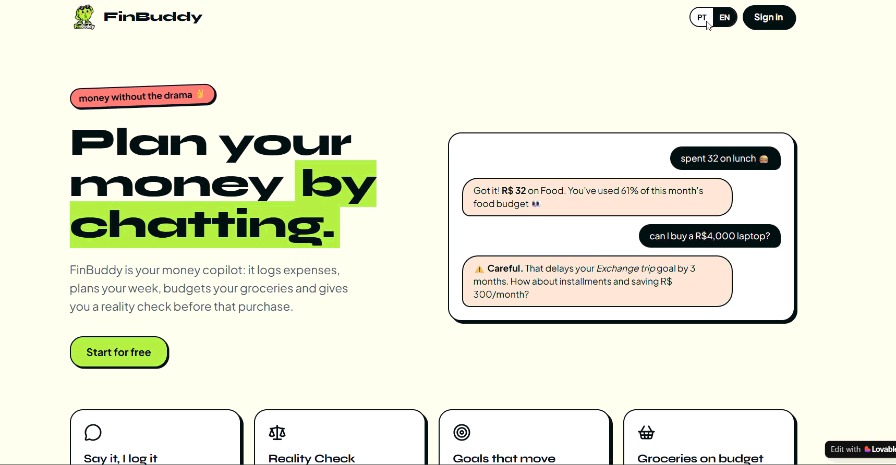
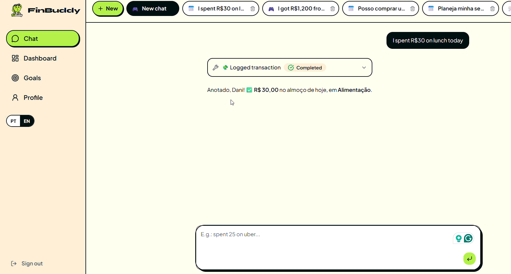
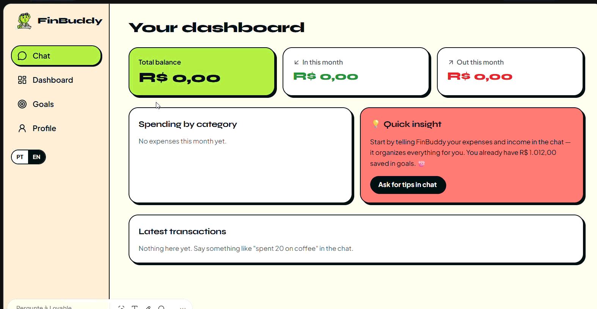
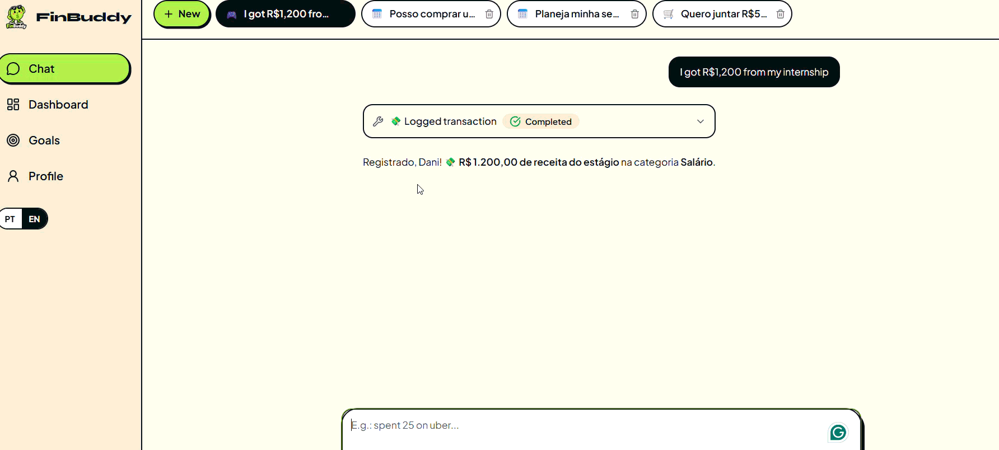
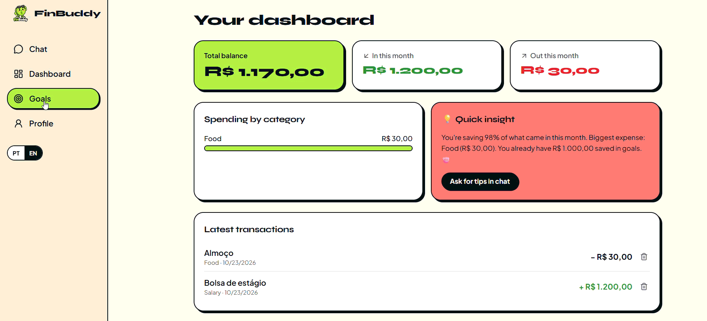

    <b>Select a language:</b> 
    <button><a href ="../README.md">Português</a></button>

# 💸 FinBuddy: Money Management Without the Drama

> A personal finance organization app created using the concepts of Vibe Coding, Artificial Intelligence, and MVP planning.

## 📖 About the Project

This project was developed as part of DIO's **Personal Finance Organization App with Vibe Coding** challenge.

The goal was to use AI as a creative partner to turn an idea into a product concept, exploring communication techniques, prompt construction, and requirements definition without necessarily implementing the application's code.

---

# 🎯 Problem

Many people want to organize their finances but end up abandoning traditional apps because they require too much manual input, complex categorization, and offer little personalization.

This project proposes an experience based on natural conversation with AI, making financial management simpler and more accessible.

---

# 👤 Target Audience

- Young adults
- University students
- People who are new to financial education
- Users who prefer conversations over spreadsheets

---

# 🚀 Proposed Solution

The app works as an intelligent financial assistant capable of:

- Recording expenses through conversations
- Recording income in natural language
- Automatically categorizing expenses
- Suggesting savings plans
- Helping users create financial goals
- Generating simple, intuitive reports
- Creating routine plans related to finances and spending

---

# 📝 Final PRD (Prompt Used)

    # Context

    I want to create an app called **FinBuddy**, a conversational financial assistant aimed at young adults from Generation Z.

    The goal is to help users better plan their financial lives through natural conversations with AI, eliminating the need for complex spreadsheets, lengthy forms, and bureaucratic processes.

    FinBuddy will not simply be an expense-tracking app. It will act as a personal financial copilot, helping users to:

    - Record expenses and income through conversation.
    - Plan their week.
    - Organize financial goals.
    - Plan meals and shopping.
    - Evaluate spending decisions.
    - Better understand their financial habits.

    The experience should be simple, friendly, modern, and adapted to the behavior of users who already use tools such as WhatsApp, Discord, ChatGPT, and TikTok.

    ---

    # Problem

    Many young adults want to organize their finances but struggle because current apps:

    - Require too much manual input.
    - Have complex interfaces.
    - Do not help with day-to-day planning.
    - Offer little personalization.
    - Only record expenses without helping users make decisions.

    As a result, users quickly abandon financial tracking and continue making decisions without planning.

    FinBuddy should solve this problem by using conversational AI to guide users before, during, and after their financial decisions.

    ---

    # Target Audience

    ## Primary Audience

    Young adults aged 18 to 30:

    - University students.
    - Interns.
    - Young professionals.
    - Freelancers.
    - People beginning their financial independence.

    ## Characteristics

    - Prefer simple and quick experiences.
    - Are used to conversation-based interfaces.
    - Have limited financial knowledge.
    - Like personalization and immediate feedback.
    - Need help planning expenses and achieving goals.

    ---

    # Value Proposition

    > Plan your financial life through conversation.

    Instead of merely tracking expenses, FinBuddy helps users build healthy financial habits through planning, guidance, and personalized follow-up.

    ---

    # Key Features

    ## Financial Management

    1. Record expenses using natural language.
    2. Record income using natural language.
    3. Automatically categorize transactions.
    4. Display a simplified financial dashboard.
    5. Generate personalized reports and insights.

    ## Financial Goals

    6. Create financial goals.
    7. Track goal progress.
    8. Simulate scenarios to achieve goals.

    ## Financial Agent

    9. Answer financial questions.
    10. Provide personalized money-saving tips.
    11. Identify spending patterns.
    12. Alert users to behaviors that may interfere with their financial goals.

    ## Reality Check

    13. Evaluate the impact of purchases before they happen.

    Example:

    > Can I buy a R$4,000 laptop?

    The AI should analyze the user's balance, budget, and goals before answering.

    ## Financial Planning

    14. Create weekly plans.
    15. Estimate future expenses.
    16. Organize budgets for events and goals.

    ## Meal and Shopping Planning

    17. Generate shopping lists based on the available budget.
    18. Suggest meals that fit the budget.
    19. Help users save money on food.
    20. Plan weekly grocery expenses.

    ---

    # Product Personality

    Users should be able to choose the style of the Financial Agent:

    - 🫂 Best Friend
    - 🎯 Reality Check
    - 🚀 Coach
    - 🤖 Geek

    All communication should use informal, welcoming, accessible language for young adults.

    ---

    # Product Differentiators

    - Natural-language conversations.
    - Proactive financial planning.
    - Budget-based meal planning.
    - Smart shopping lists.
    - Financial decision simulations.
    - Personalized insights.
    - Customizable AI personality.
    - An experience designed for Generation Z.

    ---

    # AI Deliverable

    Generate a complete MVP plan containing:

    1. Product overview.
    2. MVP features.
    3. Main user flow.
    4. Key screens.
    5. Navigation structure.
    6. Functional requirements.
    7. Non-functional requirements.
    8. Success metrics.
    9. Validation hypotheses.
    10. Future features (V2).

    Use clear, educational, and accessible language.

    The result should be detailed enough to serve as a basis for UX/UI design, product documentation, and development using Vibe Coding tools.

# ✅ MVP Plan

## Essential Features

- [ ] Record expenses through conversation
- [ ] Record income
- [ ] Automatic categorization
- [ ] Financial goals
- [ ] Basic reports

***

# FinBuddy Evaluation Criteria

The application must comply with the following business rules.

# CONTINUOUS AUDIT PROMPT

At the end of every change, feature, or screen implementation, analyze the project using the criteria below.

For each item, return:

- ✅ Implemented
- 🟡 Partially implemented
- ❌ Not implemented

In addition:

- Explain the reason for the classification.
- Specify exactly what is missing to achieve ✅.
- List visual, technical, or functional inconsistencies.
- Do not assume something is complete without checking the code.
- Always treat the PRD as the source of truth.

---

# Prompt Provided to Lovable for the First App Iteration + Lovable's Questions About My App

[Questions + Prompt](assets_english/FinBuddy_Chat_Setup_Interface.png)  

[Prompt for Lovable](assets_english\prompt_for_lovable.txt)
---

# PRODUCT AUDIT

## Onboarding

- [ ] Splash screen implemented
- [ ] Google sign-in
- [ ] Apple sign-in
- [ ] Email/password sign-in
- [ ] Monthly income step
- [ ] Personality selection step
- [ ] First fixed expense or financial goal step

---

# NAVIGATION AUDIT

## Mobile

- [ ] Chat
- [ ] Dashboard
- [ ] Transactions
- [ ] Planning
- [ ] Goals
- [ ] Settings

## Web

- [ ] Top navigation menu implemented
- [ ] Responsive layout
- [ ] Desktop compatibility

---

# AI CHAT AUDIT

- [ ] Functional chat input
- [ ] Natural language processing
- [ ] Expense recording
- [ ] Income recording
- [ ] Confirmation card
- [ ] Editing before saving
- [ ] Data persistence

---

# DASHBOARD AUDIT

- [ ] Actual Available Balance
- [ ] Pending Fixed Expenses
- [ ] Goal Progress
- [ ] Spending by Category
- [ ] Financial Insights

---

# TRANSACTIONS AUDIT

## Cards

- [ ] Display income
- [ ] Display expenses
- [ ] Filters

## Spreadsheet

- [ ] Create a transaction
- [ ] Edit a transaction
- [ ] Delete a transaction
- [ ] Data persistence

---

# REALITY CHECK AUDIT

## Formulas

- [ ] SLC implemented
- [ ] GFC implemented
- [ ] SRD implemented
- [ ] ML implemented

## Results

- [ ] Green Zone
- [ ] Yellow Zone
- [ ] Red Zone

## Explanations

- [ ] Green explanatory card
- [ ] Yellow explanatory card
- [ ] Red explanatory card

## Validation

- [ ] Result based on calculations
- [ ] Does not rely solely on AI

---

# GOALS AUDIT

- [ ] Create a goal
- [ ] Edit a goal
- [ ] Delete a goal
- [ ] Add a contribution
- [ ] Update progress
- [ ] Contribution history

---

# FIXED EXPENSES AUDIT

- [ ] Create a fixed expense
- [ ] Edit a fixed expense
- [ ] Delete a fixed expense
- [ ] Mark as paid
- [ ] Mark as pending
- [ ] Automatic monthly reset

---

# PLANNING AUDIT

- [ ] Create a week
- [ ] Checklist
- [ ] Data persistence
- [ ] Generate a plan with AI
- [ ] Weekly history

---

# CATEGORIES AUDIT

- [ ] Create a category
- [ ] Edit a category
- [ ] Delete a category
- [ ] Reassign transactions

---

# PERSONALITIES AUDIT

- [ ] Best Friend
- [ ] Reality Check
- [ ] Coach
- [ ] Geek

---

# DATABASE AUDIT

- [ ] `profiles`
- [ ] `categories`
- [ ] `transactions`
- [ ] `goals`
- [ ] `goal_contributions`
- [ ] `fixed_expenses`
- [ ] `fixed_expense_payments`
- [ ] `weekly_plans`
- [ ] `weekly_plan_items`

---

# SECURITY AUDIT

- [ ] Supabase Auth
- [ ] RLS enabled
- [ ] User-level data isolation
- [ ] Data protected

---

# UI AUDIT

## Design System

- [ ] Official color palette used

### Colors

- [ ] Royal Purple (#4B3F72)
- [ ] Sky Blue (#89BEE3)
- [ ] Pastel Pink (#F7C5D6)
- [ ] Cream (#F3EFE6)

## Indicators

- [ ] Green (#7BC67E)
- [ ] Yellow (#F4C95D)
- [ ] Red (#E76F51)

## Consistency

- [ ] Standardized components
- [ ] Dark mode
- [ ] Mobile-first layout
- [ ] Responsiveness

---

# FINAL AUDIT

The report must include the following sections.

## Overall Progress

X% complete

## Completed Features

- Item
- Item
- Item

## Incomplete Features

- Item
- Item
- Item

## Bugs Found

- Bug
- Bug

## Deviations from the PRD

- Deviation
- Deviation

## Recommended Next Task

Explain which feature should be implemented next to deliver the greatest possible value to the product.

***

# 🖼️ Evidences

## FinBuddy Prototypes

### Login:

### Chating with the chatbot:

note: there's an issue regarding the chatbot translation from PT to EN.

### Adding money:

### Spendings:

### Adding goals: 

***

# Try FinBuddy:

<button><a href="https://finbuddygenz.lovable.app/auth">FinBuddy.App</a></button>

# 📚 Lessons Learned

During this challenge, I learned:

- How to write better prompts.
- How to turn ideas into deliverables.
- Prompt development.
- Concepts such as RLS, Tailwind CSS, and PRDs.

